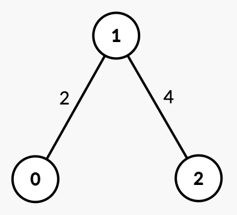

# [3608. Minimum Time for K Connected Components](https://leetcode.com/problems/minimum-time-for-k-connected-components/)

| Category | Difficulty | Likes | Dislikes |
| :------: | :--------: | :---: | :------: |
| Algorithms | Medium | 109 | 6 |

**Tags:** [`binary-search`](https://leetcode.com/tag/binary-search), [`union-find`](https://leetcode.com/tag/union-find), [`graph`](https://leetcode.com/tag/graph), [`sorting`](https://leetcode.com/tag/sorting)

**Companies:** `phonepe`, `amazon`

## Description

You are given an integer `n` and an undirected graph with `n` nodes labeled from 0 to `n - 1`. This is represented by a 2D array `edges`, where `edges[i] = [u_i, v_i, time_i]` indicates an undirected edge between nodes `u_i` and `v_i` that can be removed at `time_i`.

You are also given an integer `k`.

Initially, the graph may be connected or disconnected. Your task is to find the **minimum** time `t` such that after removing all edges with `time <= t`, the graph contains **at least** `k` connected components.

Return the **minimum** time `t`.

A **connected component** is a subgraph of a graph in which there exists a path between any two vertices, and no vertex of the subgraph shares an edge with a vertex outside of the subgraph.

 

**Example 1:**

**Input:** n = 2, edges = [[0,1,3]], k = 2

**Output:** 3

**Explanation:**

	- Initially, there is one connected component `{0, 1}`.

	- At `time = 1` or `2`, the graph remains unchanged.

	- At `time = 3`, edge `[0, 1]` is removed, resulting in `k = 2` connected components `{0}`, `{1}`. Thus, the answer is 3.

**Example 2:**

**Input:** n = 3, edges = [[0,1,2],[1,2,4]], k = 3

**Output:** 4

**Explanation:**

	- Initially, there is one connected component `{0, 1, 2}`.

	- At `time = 2`, edge `[0, 1]` is removed, resulting in two connected components `{0}`, `{1, 2}`.

	- At `time = 4`, edge `[1, 2]` is removed, resulting in `k = 3` connected components `{0}`, `{1}`, `{2}`. Thus, the answer is 4.

**Example 3:**

**Input:** n = 3, edges = [[0,2,5]], k = 2

**Output:** 0

**Explanation:**

	- Since there are already `k = 2` disconnected components `{1}`, `{0, 2}`, no edge removal is needed. Thus, the answer is 0.

 

**Constraints:**

	- `1 <= n <= 10^5`

	- `0 <= edges.length <= 10^5`

	- `edges[i] = [u_i, v_i, time_i]`

	- `0 <= u_i, v_i < n`

	- `u_i != v_i`

	- `1 <= time_i <= 10^9`

	- `1 <= k <= n`

	- There are no duplicate edges.

---

**Links:** [Submissions](https://leetcode.com/problems/minimum-time-for-k-connected-components/) | [Solutions](https://leetcode.com/problems/minimum-time-for-k-connected-components/)
