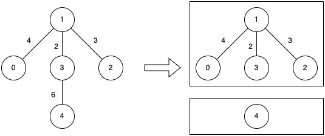

# [3613. Minimize Maximum Component Cost](https://leetcode.com/problems/minimize-maximum-component-cost/)

| Category | Difficulty | Likes | Dislikes |
| :------: | :--------: | :---: | :------: |
| Algorithms | Medium | 110 | 9 |

**Tags:** [`binary-search`](https://leetcode.com/tag/binary-search), [`union-find`](https://leetcode.com/tag/union-find), [`graph`](https://leetcode.com/tag/graph), [`sorting`](https://leetcode.com/tag/sorting)

**Companies:** `apple`, `salesforce`

## Description

You are given an undirected connected graph with n nodes labeled from 0 to n - 1 and a 2D integer array edges where edges[i] = [ui, vi, wi] denotes an undirected edge between node ui and node vi with weight wi, and an integer k.

You are allowed to remove any number of edges from the graph such that the resulting graph has **at most** k connected components.

The **cost** of a component is defined as the **maximum** edge weight in that component. If a component has no edges, its cost is 0.

Return the **minimum** possible value of the **maximum** cost among all components **after such removals**.

 

**Example 1:**

**Input:** n = 5, edges = [[0,1,4],[1,2,3],[1,3,2],[3,4,6]], k = 2

**Output:** 4

**Explanation:**

	Remove the edge between nodes 3 and 4 (weight 6).
	The resulting components have costs of 0 and 4, so the overall maximum cost is 4.

**Example 2:**

**Input:** n = 4, edges = [[0,1,5],[1,2,5],[2,3,5]], k = 1

**Output:** 5

**Explanation:**

	No edge can be removed, since allowing only one component (`k = 1`) requires the graph to stay fully connected.
	That single component&rsquo;s cost equals its largest edge weight, which is 5.

 

**Constraints:**

	- `1 <= n <= 5 * 10^4`

	- `0 <= edges.length <= 10^5`

	- `edges[i].length == 3`

	- `0 <= u_i, v_i < n`

	- `1 <= w_i <= 10^6`

	- `1 <= k <= n`

	- The input graph is connected.

---

**Links:** [Submissions](https://leetcode.com/problems/minimize-maximum-component-cost/) | [Solutions](https://leetcode.com/problems/minimize-maximum-component-cost/)
