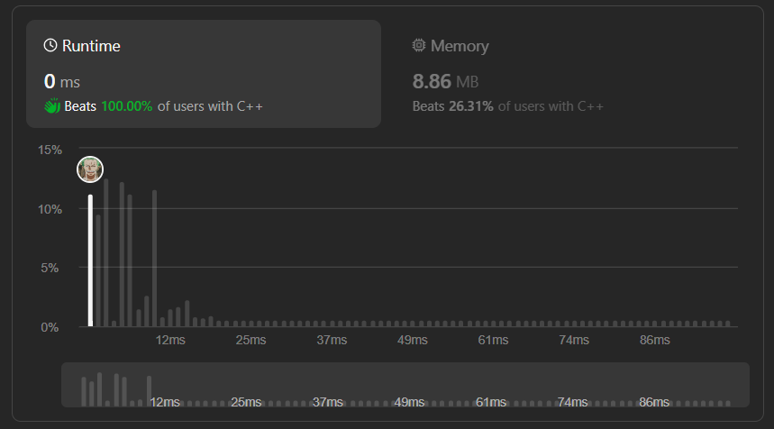

# ✅☑Beats 100% Users || [C++/Java/Python/JavaScript] || EXPLAINED🔥

**Author:** MarkSPhilip31
**Votes:** 307
**Link:** [https://leetcode.com/problems/bitwise-and-of-numbers-range/solutions/4759881/](https://leetcode.com/problems/bitwise-and-of-numbers-range/solutions/4759881/)

---

# DO GIVE IT A LIKE IF THAT WAS HELPFUL\uD83E\uDEE1\uD83D\uDC47


---



---


# Approaches
(Also explained in the code)

1. **Common Prefix Identification:**

    - The function iteratively right-shifts both `left` and `right` until they become equal, identifying the common prefix of their binary representations.
1. **Counting Shifts:**

    - It counts the number of right-shifts performed, storing the count in the variable `cnt`.
1. **Bitwise AND Calculation:**

    - After finding the common prefix, it reconstructs the bitwise AND result by left-shifting the common prefix by `cnt` bits.

```left_=5_and_right_=7 []
Lets manually apply & operation on all elements present in the 
range 5 and 7 including themself.

            5 = 101
            6 = 110
            7 = 111

AND operations:
            0 & 0 = 0
            0 & 1 = 0
            1 & 0 = 0
            1 & 1 = 1

With the help of above operations lets perform AND operations.

            101(5) & 110(6) = 100(4)

            100(4) & 111(7) = 100(4)

    answer = 4


Now lets apply the method used in the code:

we will remove last digit from binary representation of both left
and right number until we reach a point where both have same 
element at the same position.
And will also keep track of how many times we removed elements 
by keeping a count of it.

lets apply it practically:

first loop:
            101 >> 1 = 10
            111 >> 1 = 11
            cnt = 1

Second loop:
            10 >> 1 = 1
            11 >> 1 = 1
            cnt = 2

Third loop:
            1 == 1 
So now since they are equal we will add those many 0's at the 
end of the current element we have by using left shift operator.

            1 << cnt  = 1 << 2  => 100(4) 


    Result = 4


```
.
```NOTE\uD83D\uDDD2\uD83D\uDE80 []
In both right and left shift, elements will be removed and added 
from the last only.
```


# Complexity
- Time complexity:
   $$O(1)$$
    

- Space complexity:
   $$O(1)$$
    


# Code
```C++ []

class Solution {
public:
    int rangeBitwiseAnd(int left, int right) {
        int cnt = 0;
        while (left != right) {
            left >>= 1;
            right >>= 1;
            cnt++;
        }
        return (left << cnt);
    }
};


```
```Java []
class Solution {
    public int rangeBitwiseAnd(int left, int right) {
        int cnt = 0;
        while (left != right) {
            left >>= 1;
            right >>= 1;
            cnt++;
        }
        return (left << cnt);
    }
}


```
```python3 []
class Solution:
    def rangeBitwiseAnd(self, left: int, right: int) -> int:
        cnt = 0
        while left != right:
            left >>= 1
            right >>= 1
            cnt += 1
        return left << cnt


```
```javascript []
var rangeBitwiseAnd = function(left, right) {
    let cnt = 0;
    while (left !== right) {
        left >>= 1;
        right >>= 1;
        cnt++;
    }
    return left << cnt;
};


```
---


# DO GIVE IT A LIKE IF THAT WAS HELPFUL\uD83E\uDEE1\uD83D\uDC47

---
---


---