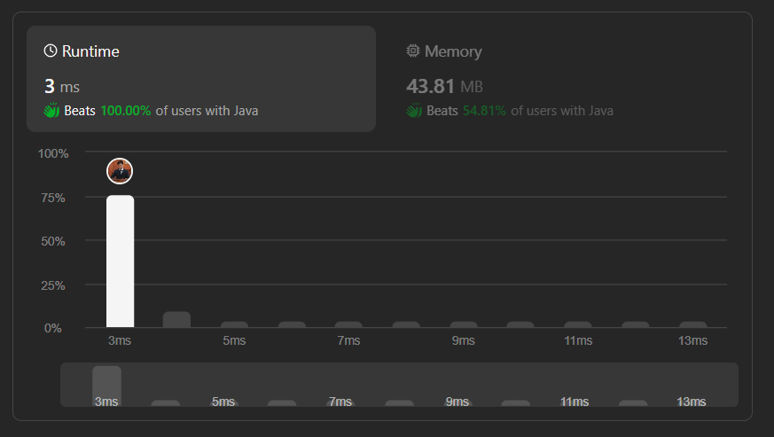

# ✅✅Beats 100% || Java, C++, Python 🔥🔥 || Solution With Explaintion✅

**Author:** dharmikgohil
**Votes:** 3
**Link:** [https://leetcode.com/problems/bitwise-and-of-numbers-range/solutions/4762177/](https://leetcode.com/problems/bitwise-and-of-numbers-range/solutions/4762177/)

---




# Intuition
The problem requires finding the bitwise AND of all numbers in the range from left to right, inclusive. We need to optimize this operation to achieve the desired result efficiently.

# Approach
We'll explore two approaches to solve this problem:

## Using Shift Operator for Optimization
We iterate through the bits of left and right simultaneously, right-shifting both until they become equal. This process identifies the common most significant bit (MSB). Then, we left-shift left by the number of bits we shifted to the right, effectively preserving the common MSB and zeroing out the rest. This operation ensures that all bits after the common MSB between left and right are set to zero, satisfying the bitwise AND condition.

## Using For Loop
We iterate through all the numbers from left + 1 to right, performing a bitwise AND operation with n for each iteration. This approach ensures that the result satisfies the bitwise AND condition by considering each number in the range.

# Complexity
## Using Shift Operator for Optimization:
- Time complexity: O(1)
- Space complexity: O(1)

## Using For Loop:
- Time complexity: O(n)
- Space complexity: O(1)

# Java
```
class Solution {
    public int rangeBitwiseAnd(int left, int right) {
        // Using Shift Operator for Optimization

        int shift = 0;
        // Find the common MSB (Most Significant Bit) of left and right
        while (left < right) {
            left >>= 1;
            right >>= 1;
            shift++;
        }
        // Shift left by the common MSB to get the result
        int optimizedResult = left << shift;
        return optimizedResult;


        // Using For Loop

        // int result = left;
        // for (int i = left + 1; i <= right; i++) {
        //    result &= i;
        //    if (result == 0) {
        //        break;
        //    }
        // }

        // return result;
    }
}
```
# C++
```
class Solution {
public:
    int rangeBitwiseAnd(int left, int right) {
        int shift = 0;
        // Find the common MSB (Most Significant Bit) of left and right
        while (left < right) {
            left >>= 1;
            right >>= 1;
            shift++;
        }
        // Shift left by the common MSB to get the result
        int optimizedResult = left << shift;
        return optimizedResult;


        // Using For Loop
        
        //int result = left;
        //for (int i = left + 1; i <= right; i++) {
        //    result &= i;
        //    if (result == 0) {
        //        break;
        //    }
        // }
        // return result;
    }
};
```
# Python
```
class Solution:
    def rangeBitwiseAnd(self, left: int, right: int) -> int:
        shift = 0
        # Find the common MSB (Most Significant Bit) of left and right
        while left < right:
            left >>= 1
            right >>= 1
            shift += 1
        # Shift left by the common MSB to get the result
        optimized_result = left << shift
        return optimized_result

        # Using For Loop
        """
        result = left
        for i in range(left + 1, right + 1):
            result &= i
            if result == 0:
                break
        return result
        """
```
# JavaScript

```
/**
 * @param {number} left
 * @param {number} right
 * @return {number}
 */
var rangeBitwiseAnd = function(left, right) {
     let shift = 0;
    while (left < right) {
        left >>= 1;
        right >>= 1;
        shift++;
    }
    let optimizedResult = left << shift;
    return optimizedResult;

    // Using For Loop

    // let result = left;
    // for (let i = left + 1; i <= right; i++) {
    //   result &= i;
    //   if (result === 0) {
    //       break;
    //   }
    // }

    // return result;
    
};
```
# C
```
int rangeBitwiseAnd(int left, int right) {
    int shift = 0;
    while (left < right) {
        left >>= 1;
        right >>= 1;
        shift++;
    }
    int optimizedResult = left << shift;
    return optimizedResult;

    // Using For Loop

    // int result = left;
    // for (int i = left + 1; i <= right; i++) {
    //   result &= i;
    //   if (result == 0) {
    //       break;
    //   }
    // }

    // return result; */
}
```
# C#

```
public class Solution {
    public int RangeBitwiseAnd(int left, int right) {
        int shift = 0;
        while (left < right) {
            left >>= 1;
            right >>= 1;
            shift++;
        }
        int optimizedResult = left << shift;
        return optimizedResult;

        // Using For Loop

        // int result = left;
        // for (int i = left + 1; i <= right; i++) {
        //   result &= i;
        //   if (result == 0) {
        //       break;
        //   }
        // }

        // return result; */
    }
}
```


# PHP
```
class Solution {
    function rangeBitwiseAnd($left, $right) {
        $shift = 0;
        while ($left < $right) {
            $left >>= 1;
            $right >>= 1;
            $shift++;
        }
        $optimizedResult = $left << $shift;
        return $optimizedResult;

    // Using For Loop

       // $result = $left;
       // for ($i = $left + 1; $i <= $right; $i++) {
       //    $result &= $i;
       //    if ($result === 0) {
       //        break;
       //    }
       // }

       // return $result; */
    }
}
```

# 

# PLEASE UPVOTE IF YOU FIND HELPFUL\uD83D\uDE4C
