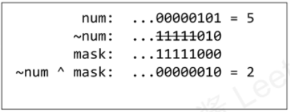

# C++ EASY TO SOLVE || Different Variations of code with detailed exaplanations

**Author:** Cosmic_Phantom
**Votes:** 107
**Link:** [https://leetcode.com/problems/number-complement/solutions/1649574/](https://leetcode.com/problems/number-complement/solutions/1649574/)

---

Given a positive integer, output its complement number. The complement strategy is to flip the bits of its binary representation.

**Intuition:-**
There is not much of a intuition in this question as the question is loud and clear about it's use of bit manipulation .

To make things a bit more interesting let's do this question with and wihout bit manipulation

* **Using Bit Manipulations:---**

**Bit masking can be summarized with this image (^_^)**
 
Thus, we can conclude that masking means to keep/change/remove a desired part of information.

**Dry run of bitmasking:-**


**Code1[Using bitmasking]:-**
```
class Solution {
public:
    int findComplement(int num) {
        unsigned mask = ~0;
        while( mask & num ) mask = mask << 1;
        return ~num ^ mask;
    }
};
```
**Time Complexity:** *`O(log(num)) = O(since we will be moving at most 32bits only) = O(1)`*
**Space Complexity:** *`O(1)`*

**Code2[Using xor]:-**
Basic idea is to find the smallest power of 2 that is larger than the `input number num`, and output the difference between `powerof2s` and `num` . 

**Dry run:-**
```
For example let's the example from description of the question:-
Input: num = 5(101) ,
Thus the smallest power of 2 (and larger than 5) is 8 (1000)
The output should be 8 - 5 - 1 = 2 (010).
```

```
class Solution {
public:
    int findComplement(int num) {
        long powerof2s = 2, temp = num;
        
        while(temp>>1) {
            temp >>= 1;
            powerof2s <<= 1;
        }
        
        return powerof2s - num - 1;
    }
};
```
.

* **Without using Bit manipulation:-**

***Code:-***
```
class Solution {
public:
    int findComplement(int num) {
        vector<int> temp; 
		// convert to binary representation
        while( num != 0 ){
            temp.push_back( num % 2 );
            num /= 2;
        } 
		// make complement
        for(int i=0; i<temp.size(); i++){
            if( temp[i] == 1 ) temp[i] = 0;
            else if( temp[i] == 0 ) temp[i] = 1;
        } int res = 0;
        for(int i=temp.size()-1; i>-1; i--) res = res * 2 + temp[i];
        return res;
    }
};
```

