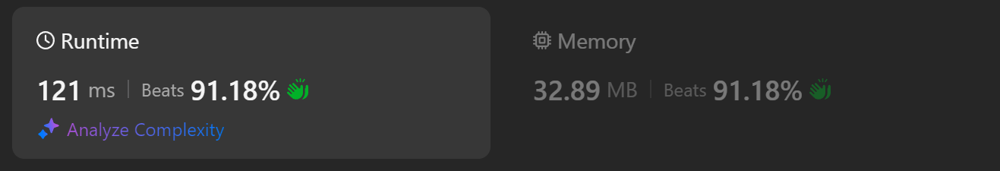
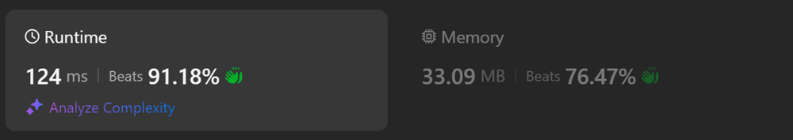

# Kotlin. Beats 100% (112 ms). Calculate mask then xor.

**Author:** mobdev778
**Votes:** 4
**Link:** [https://leetcode.com/problems/number-complement/solutions/5673255/](https://leetcode.com/problems/number-complement/solutions/5673255/)

---


# Code
```kotlin []
class Solution {
    fun findComplement(num: Int): Int {
        var n = num
        var mask = 0
        while (n != 0) {
            n = n shr 1
            mask = mask shl 1 or 1
        }
        return num xor mask
    }
}
```

# Approach

The  algorithm is simple - we must first calculate a mask of ones for all the bits that are included in the given number. For example, for the number 5 (101b) this will be a mask of 7 (111b).

The next step is to XOR the mask and the number so that the result will be bits that are not included in the initial number:

```
111 x 101 = 010
```

010b = 2

# Alternative approaches

1. "Integer.takeHighestOneBit".

Alternatively, we can use the "Integer.takeHighestOneBit()" operation with a pre-computed set of masks for all 32 variants, but it is slower, because the "Integer.takeHighestOneBit()" operation does a lot of calculations internally (bitwise shifts).


```
class Solution {
    fun findComplement(num: Int): Int {
        return num xor (masks[num.takeHighestOneBit()] ?: 0)
    }

    companion object {
        val masks = TreeMap<Int, Int>()

        init {
            for (i in 0..32) {
                val bit = 1 shl i
                masks.put(bit, (bit shl 1) - 1)
            }
        }
    }
}
```

2. Direct xoring 



```
class Solution {
    fun findComplement(num: Int): Int {
        var n = num

        var result = 0
        var offset = 0
        for (i in 0 until 31) {
            if (n == 0) break
            val bit = (n and 1) xor 1
            result = result or (bit shl offset)
            offset++
            n = n shr 1
        }

        return result
    }
}
```

3. Direct xoring #2



```
class Solution {
    fun findComplement(num: Int): Int {
        var n = num

        var result = 0
        for (i in 0 until 31) {
            if (n == 0) break
            result = result or ((1 shl i xor num) and (1 shl i))
            n = n shr 1
        }

        return result
    }
}
```

4. Direct xoring #3

It is also worth noting that we do not use the 31st bit, since it is the sign bit.


```
class Solution {
    fun findComplement(num: Int): Int {
        var result = 0
        for (i in 0 until 31) {
            val bit = 1 shl i
            if (bit > num) break
            result = result or ((num and bit) xor bit)
        }
        return result
    }
}
```