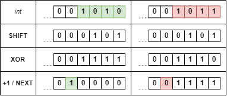

# Bit Manipulation 1-liner

**Author:** benenb
**Votes:** 0
**Link:** [https://leetcode.com/problems/binary-number-with-alternating-bits/solutions/5523358/](https://leetcode.com/problems/binary-number-with-alternating-bits/solutions/5523358/)

---

# Steps
<!-- Describe your approach to solving the problem. -->
- shift all bits by -1
- XOR with original value
- add 1 to the result
- if the bit after the previous most significant bit is set then the bits were alternating

# Illustration



# Code
```
# @param {Integer} n
# @return {Boolean}
def has_alternating_bits(n)
    (n ^ (n << -1)).next[n.bit_length] > 0
end
```