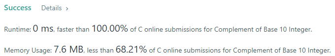
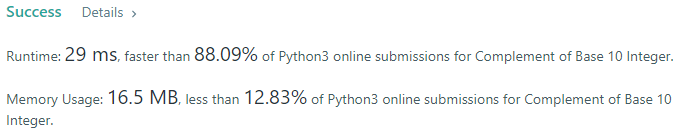
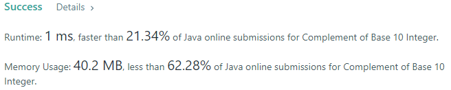
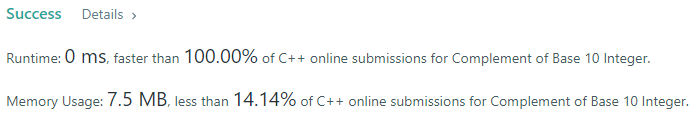

# 💢☠💫Easiest👾Faster✅💯 Lesser🧠 🎯 C++✅Python3🐍✅Java✅C✅Python🐍✅C#✅💥🔥💫Explained☠💥🔥 Beats 100

**Author:** Edwards310
**Votes:** 4
**Link:** [https://leetcode.com/problems/complement-of-base-10-integer/solutions/5674654/](https://leetcode.com/problems/complement-of-base-10-integer/solutions/5674654/)

---

# Intuition





<!-- Describe your first thoughts on how to solve this problem. -->
```javascript []
//JavaScript Code
/**
 * @param {number} n
 * @return {number}
 */
var bitwiseComplement = function(n) {
    if(n === 0)
        return 1
    let i
    for(i = 1; i <= n; i *= 2)
        n = n ^ i
    return n
};
```
```C++ []
//C++ Code
class Solution {
public:
    int bitwiseComplement(int num) {
        int m = num;
        int mask = 0;
        if(num == 0)
            return 1;
        
        while(m != 0){
            mask = (mask << 1) | 1;
            m = m >> 1;
        }
        int ans = (~num) & mask;
        return ans;
    }
};
```
```Python3 []
#Python3 Code
class Solution:
    def bitwiseComplement(self, num: int) -> int:
        if num == 0: return 1
        mask = 0
        temp = num
        while temp:
            mask = (mask << 1) | 1
            temp >>= 1
        return num ^ mask
```
```Java []
//Java Code
class Solution {
    public int bitwiseComplement(int n) {
        StringBuilder res = new StringBuilder("");
        String t = Integer.toBinaryString(n);
        for(char x : t.toCharArray()){
            if(x == '1')
                res.append('0');
            else
                res.append('1');
        }

        return  Integer.parseInt(res.toString(), 2);
    }
}
```
```C []
//C Code
int bitwiseComplement(int num) {
    int m = num;
    int mask = 0;
    if(num == 0)
        return 1;
    
    while(m != 0){
        mask = (mask << 1) | 1;
        m = m >> 1;
    }
    int ans = (~num) & mask;
    return ans;
}
```
```Python []
#Python Code
class Solution(object):
    def bitwiseComplement(self, num):
        """
        :type n: int
        :rtype: int
        """
        if num == 0: return 1
        mask = 0
        temp = num
        while temp:
            mask = (mask << 1) | 1
            temp >>= 1
        return num ^ mask
```
```C# []
//C# Code
public class Solution {
    public int BitwiseComplement(int num) {
        int m = num;
        int mask = 0;
        if(num == 0)
            return 1;
        
        while(m != 0){
            mask = (mask << 1) | 1;
            m = m >> 1;
        }
        int ans = (~num) & mask;
        return ans;
    }
}
```

# Approach
<!-- Describe your approach to solving the problem. -->

# Complexity
- Time complexity:
<!-- Add your time complexity here, e.g. $$O(n)$$ -->
     O(n)
- Space complexity:
<!-- Add your space complexity here, e.g. $$O(n)$$ -->
     O(1)
# Code
