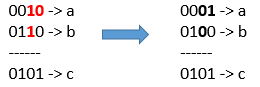

# [1318. Minimum Flips to Make a OR b Equal to c](https://leetcode.com/problems/minimum-flips-to-make-a-or-b-equal-to-c/)

| Category | Difficulty | Likes | Dislikes |
| :------: | :--------: | :---: | :------: |
| Algorithms | Medium | 2118 | 111 |

**Tags:** [`bit-manipulation`](https://leetcode.com/tag/bit-manipulation)

**Companies:** `microsoft`

## Description

Given 3 positives numbers `a`, `b` and `c`. Return the minimum flips required in some bits of `a` and `b` to make ( `a` OR `b` == `c` ). (bitwise OR operation).

Flip operation consists of change **any** single bit 1 to 0 or change the bit 0 to 1 in their binary representation.


 


**Example 1:**





```

Input: a = 2, b = 6, c = 5
Output: 3
Explanation: After flips a = 1 , b = 4 , c = 5 such that (a OR b == c)
```


**Example 2:**


```

Input: a = 4, b = 2, c = 7
Output: 1

```


**Example 3:**


```

Input: a = 1, b = 2, c = 3
Output: 0

```


 


**Constraints:**


	- `1 <= a <= 10^9`

	- `1 <= b <= 10^9`

	- `1 <= c <= 10^9`

---

**Links:** [Submissions](https://leetcode.com/problems/minimum-flips-to-make-a-or-b-equal-to-c/) | [Solutions](https://leetcode.com/problems/minimum-flips-to-make-a-or-b-equal-to-c/)
