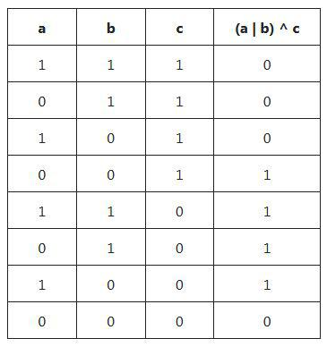
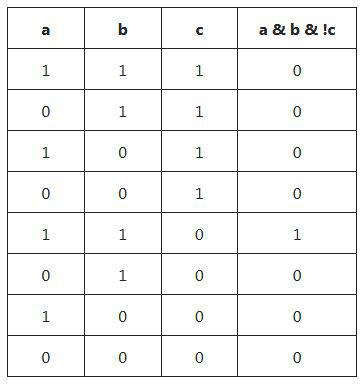

# One-liner explained

**Author:** VladimirTheLeet
**Votes:** 4
**Link:** [https://leetcode.com/problems/minimum-flips-to-make-a-or-b-equal-to-c/solutions/3606698/](https://leetcode.com/problems/minimum-flips-to-make-a-or-b-equal-to-c/solutions/3606698/)

---

Xor operation **^** is an "inequality testing" operator, i.e. if we want to test whether **x $\
eq $ y** (bitwise speaking), we use **x ^ y** which yields 1 for non-equal and 0 for equal.
So, here we test values **a | b** vs **c**
**(a | b) ^ c** gives almost what we need, except for the nasty case of **a = 1, b = 1, c = 0** when it takes not one but two flips to change the outcome of **a | b**. So we just add 1 to the result for that case, that's where **a & b & ~c** comes from.
The resulting formula provides the desired answer for any triple of corresponding bits from a, b, and c. And to get the result for the whole number, use the property with self-explanatory name `nonzeroBitCount` (or its equivalent in your language of choice).

```
func minFlips(_ a: Int, _ b: Int, _ c: Int) -> Int {
    ((a | b) ^ c).nonzeroBitCount + (a & b & ~c).nonzeroBitCount
}
```


