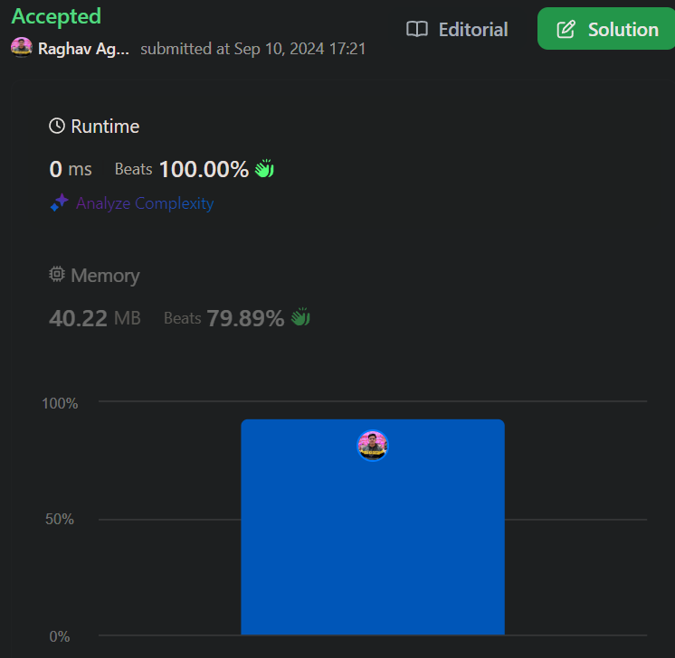

# Most easy || beats 100% || Best Solution || All languages

**Author:** raghavagarwal28
**Votes:** 173
**Link:** [https://leetcode.com/problems/minimum-bit-flips-to-convert-number/solutions/5765774/](https://leetcode.com/problems/minimum-bit-flips-to-convert-number/solutions/5765774/)

---



# Intuition
The question asks how few bit flips are necessary to change one integer into another. It follows easily that the bits of the two numbers can be compared. The amount of flips required will depend on how the bits in the binary representation of start and aim differ from one another. The result of a bitwise XOR operation between start and goal is a number where each 1 denotes a location where the bits of the two numbers differ. The necessary number of bit flips can be found by counting the 1s in this XOR result.

# Approach
1) XOR the two numbers: Perform a bitwise XOR between start and goal. The result will have 1 in positions where the bits are different between the two numbers.
2) Count the number of 1s in the XOR result: This tells us the number of positions where the bits differ and hence the number of bit flips required.
3) Bit counting: Use a loop to repeatedly check the last bit of the XOR result using & 1. Right shift the XOR result (>> 1) to process the next bit. Continue until all bits are processed.

# Complexity
- Time complexity:
The time complexity is O(k), where k is the number of bits in the binary representation of the larger of the two numbers (start or goal).

- Space complexity:
The space complexity is O(1).

# Code
```java []
class Solution {
    public int minBitFlips(int start, int goal) {
        int ans = 0; 
        // XOR will give 1 where the bits are different
        int xor = start ^ goal;

        while(xor!=0){
            // If the last bit is 1, increment count 
            ans += xor & 1;

            // Right-shift to check the next bit
            xor >>=1;
        }
        return ans;
    }
}
```
``` C++ []
class Solution {
public:
    int minBitFlips(int start, int goal) {
        int xorResult = start ^ goal;
        int ans = 0;
        
        
        while (xorResult > 0) {
            ans += xorResult & 1; 
            xorResult >>= 1;
        }
        
        return ans;
    }
};
```
``` python []
class Solution(object):
    def minBitFlips(self, start, goal):
        """
        :type start: int
        :type goal: int
        :rtype: int
        """

        xor_result = start ^ goal
        ans = 0
        
        while xor_result > 0:
            ans += xor_result & 1  
            xor_result >>= 1     
        
        return ans

```
``` Javascript []
/**
 * @param {number} start
 * @param {number} goal
 * @return {number}
 */
var minBitFlips = function(start, goal) {
    // XOR to find differing bits between start and goal
    let xorResult = start ^ goal;
    let ans = 0;
    
    // Count the number of 1's in the XOR result
    while (xorResult > 0) {
        ans += xorResult & 1;  
        xorResult >>= 1;        
    }
    
    return ans;
};

```

