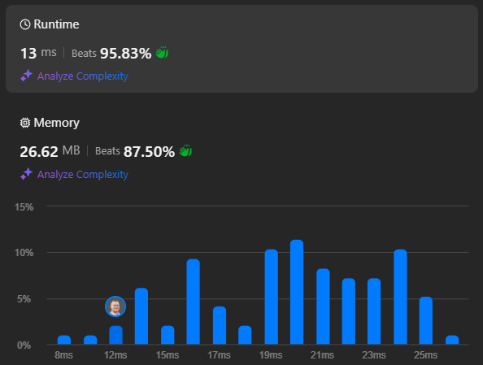

# Simple Easy "%" Approach - Beats 95% - Time O(n) Space O(1)

**Author:** bogdanctdev
**Votes:** 3
**Link:** [https://leetcode.com/problems/minimum-bit-flips-to-convert-number/solutions/5769568/](https://leetcode.com/problems/minimum-bit-flips-to-convert-number/solutions/5769568/)

---

# Intuition
We can use the `%` operator to extract the bits of a number from right to left (from the least significant bit to the most significant oane). 

Example:
- `10` in binary is `1010`. Using `% 2` iteratively on `10` gives the bits `0101` (starting from the least significant bit);
- `7` in binary is `111` (or `0111` to match the bit count with `10`). Using `% 2` four times on `7` gives `1110`.

**Note**: To iterate through all bits of a number, divide the number by `2` repeatedly until it becomes `0`.

# Approach
In order to find the minimum number of bit flips required to convert the binary representation of `start` into `goal`, we can compare the least significant bits of `start` and `goal` and increments the flip count if they differ.
We divide by 2 both `start` and `goal` until both are 0.

# Complexity
- Time complexity:
**O(n)** where n is the number of bits of the biggest number between "$$start$$" and "$$goal$$";

- Space complexity:
**O(1)**, no extra data structures were used;

# Results


# Code
```csharp []
public class Solution {
    public int MinBitFlips(int start, int goal) {
        int flips = 0;

        while (!(start == 0) || !(goal == 0))
        {
            if ((start %2) != (goal % 2))
                flips++;

            start /= 2;
            goal /= 2;    
        }

        return flips;
    }
}
```