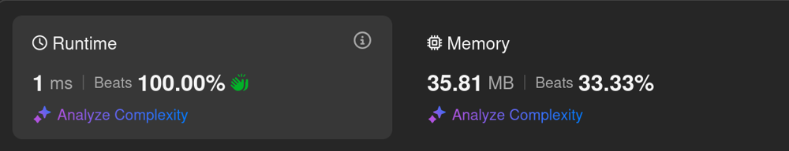

# Kotlin. Beats 100% (1 ms). Bitmasking: 0x5555 and 0xAAAA.

**Author:** mobdev778
**Votes:** 0
**Link:** [https://leetcode.com/problems/number-of-even-and-odd-bits/solutions/6003708/](https://leetcode.com/problems/number-of-even-and-odd-bits/solutions/6003708/)

---



# Code
```kotlin []
class Solution {
    fun evenOddBit(n: Int): IntArray {
        return intArrayOf(
            Integer.bitCount(n and 0x5555), // 01010101 01010101
            Integer.bitCount(n and 0xAAAA)  // 10101010 10101010
        )
    }
}
```

# Approach

We could use Integer.bitCount(), but Integr.bitCount() counts all the bits without separating them into even and odd.

To count only even or only odd bits, we can use 2 bit masks: 5555 to fffff - by applying the mask, we filter out unnecessary bits (either even or odd) and then use the standard Integer.bitCount() method, which will return us the number of bits remaining after filtering.