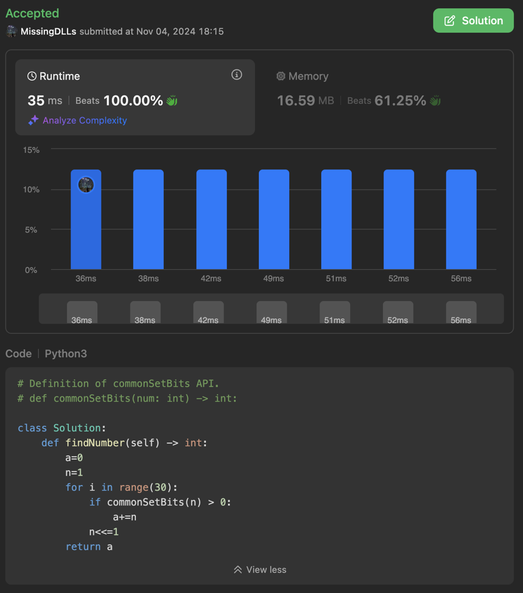

# Python3 O(N) Solution with bit operations (100.00% Runtime)

**Author:** MissingDLLs
**Votes:** 0
**Link:** [https://leetcode.com/problems/guess-the-number-using-bitwise-questions-i/solutions/6005692/](https://leetcode.com/problems/guess-the-number-using-bitwise-questions-i/solutions/6005692/)

---

# Intuition
<!-- Describe your first thoughts on how to solve this problem. -->



# Approach
<!-- Describe your approach to solving the problem. -->
- Iteratively check 1 << i with using API to check if ith bit is 1.

# Complexity
- Time complexity: O(N)
<!-- Add your time complexity here, e.g. $$O(n)$$ -->

- Space complexity: O(1)
<!-- Add your space complexity here, e.g. $$O(n)$$ -->

# Code
If this solution is similar to yours or helpful, upvote me if you don't mind
```python3 []
# Definition of commonSetBits API.
# def commonSetBits(num: int) -> int:

class Solution:
    def findNumber(self) -> int:
        a=0
        n=1
        for i in range(30):
            if commonSetBits(n) > 0:
                a+=n
            n<<=1
        return a
```