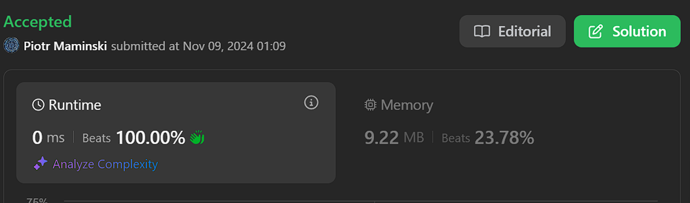
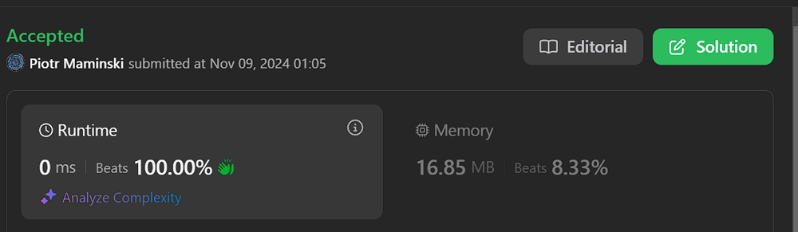

# ✅Beats 100% | O(1) | Short & Simple | Explained | Bitmasking

**Author:** Piotr_Maminski
**Votes:** 116
**Link:** [https://leetcode.com/problems/minimum-array-end/solutions/6024884/](https://leetcode.com/problems/minimum-array-end/solutions/6024884/)

---

# Aproach 1: Bitmasking (All beats 100%) 
```python3 []
class Solution:
    def minEnd(self, n: int, x: int) -> int:
        result = x
        remaining = n - 1
        position = 1
    
        while remaining:
            if not (x & position):
                result |= (remaining & 1) * position
                remaining >>= 1
            position <<= 1
    
        return result
```
```cpp []
class Solution {
public:
    long minEnd(int n, int x) {
        long result = x;
        long remaining = n - 1;
        long position = 1;
        
        while (remaining) {
            if (!(x & position)) {
                result |= (remaining & 1) * position;
                remaining >>= 1;
            }
            position <<= 1;
        }
        
        return result;
    }
};

```
```java []
class Solution {
    public long minEnd(int n, int x) {
        long result = x;
        long remaining = n - 1;
        long position = 1;
        
        while (remaining != 0) {
            if ((x & position) == 0) {
                result |= (remaining & 1) * position;
                remaining >>= 1;
            }
            position <<= 1;
        }
        
        return result;
    }
}

```
```csharp []
public class Solution {
    public long MinEnd(int n, int x) {
        long result = x;
        long remaining = n - 1;
        long position = 1;
        
        while (remaining != 0) {
            if ((x & position) == 0) {
                result |= (remaining & 1) * position;
                remaining >>= 1;
            }
            position <<= 1;
        }
        
        return result;
    }
}
```
```golang []
func minEnd(n int, x int) int64 {
    result := int64(x)
    remaining := int64(n - 1)
    position := int64(1)
    
    for remaining != 0 {
        if (int64(x) & position) == 0 {
            result |= (remaining & 1) * position
            remaining >>= 1
        }
        position <<= 1
    }
    
    return result
}

```
```swift []
class Solution {
    func minEnd(_ n: Int, _ x: Int) -> Int {
        var result = Int64(x)
        var remaining = Int64(n - 1)
        var position: Int64 = 1
        
        while remaining != 0 {
            if (Int64(x) & position) == 0 {
                result |= (remaining & 1) * position
                remaining >>= 1
            }
            position <<= 1
        }
        
        return Int(result)
    }
}
```
```javascript [JS]
// JavaScript

var minEnd = function(n, x) {
    let result = BigInt(x);
    let remaining = BigInt(n - 1);
    let position = 1n;
    
    while (remaining > 0n) {
        if ((BigInt(x) & position) === 0n) {
            result |= (remaining & 1n) * position;
            remaining >>= 1n;
        }
        position <<= 1n;
    }
    
    return Number(result);
};
```
```typescript [TS]
// TypeScript

function minEnd(n: number, x: number): number {
    let result: bigint = BigInt(x);
    let remaining: bigint = BigInt(n - 1);
    let position: bigint = 1n;
    
    while (remaining > 0n) {
        if ((BigInt(x) & position) === 0n) {
            result |= (remaining & 1n) * position;
            remaining >>= 1n;
        }
        position <<= 1n;
    }
    
    return Number(result);
}
```
```rust []
impl Solution {
    pub fn min_end(n: i32, x: i32) -> i64 {
        let mut result = x as i64;
        let mut remaining = (n - 1) as i64;
        let mut position: i64 = 1;
        
        while remaining != 0 {
            if (x as i64 & position) == 0 {
                result |= (remaining & 1) * position;
                remaining >>= 1;
            }
            position <<= 1;
        }
        
        result
    }
}

```
```ruby []
def min_end(n, x)
    result = x
    remaining = n - 1
    position = 1
    
    while remaining != 0
        if (x & position) == 0
            result |= (remaining & 1) * position
            remaining >>= 1
        end
        position <<= 1
    end
    
    result.to_i
end
```

### Complexity
- Time complexity: O(1)() ( O(b) but integers have a fixed size (32/64) )


- Space complexity: O(1)

## Explanation

1. We start with a number `x` and store it in `result`
2. `remaining` keeps track of how many bits we still need to process (n-1)
3. `position` helps us check individual bits, starting from rightmost (1)

4. Main Loop:

    - Checks each bit position in `x`
    - If there's a **0** bit in `x` at current position:
        - Takes the last bit of `remaining` (using & 1)
        - Places that bit in `result` at current position
        - Shifts `remaining` right by 1 to get next bit
    - Moves to next bit position by shifting left

Done.

Helpful? UpVote


---
# Aproach 2: PDEP Directly CPU instruction
```java []
class Solution {
    public static long minEnd(final int n, final int x) {
        return x | Long.expand(n - 1, ~(long)x);
    }
}
```
```cpp []
#include <immintrin.h>
#define BMI2 __attribute__((__target__("bmi2")))
class Solution {
public:
    static long long minEnd(const uint n, const uint x) BMI2 {
        return x | _pdep_u64(n - 1u, ~uint64_t(x));
    }
};
```
```rust []
impl Solution {
   pub fn min_end(n: i32, x: i32) -> i64 {
       #[cfg(target_arch = "x86_64")]
       unsafe {
           (x as u64 | core::arch::x86_64::_pdep_u64(n as u64 - 1, !(x as u64))) as i64
       }
   }
}
```
```C []
#include <immintrin.h>
#define BMI2 __attribute__((__target__("bmi2")))
BMI2 long long minEnd(const uint n, const uint x) {
    return x | _pdep_u64(n - 1u, ~(uint64_t)x);
}
```
Parallel Bits Deposit - most efficient, rarely supported. Time O(1) in practice  & Space O(1)

### Oryginal Sergei [Solution](https://leetcode.com/problems/minimum-array-end/solutions/6024965/bit-deposit-one-liner-beating-100-in-c-c-rust-and-python)

---


# Aproach 3:  Bit Manipulation, Greedy

```python3 []
class Solution:
    def minEnd(self, n: int, x: int) -> int:
        # Store positions where bits are 0 in x
        shifts = []
        cur = x
        # Calculate how many steps needed (n-1)
        calc = n - 1
        
        # Find positions of 0 bits in x (first 32 bits)
        for i in range(32):
            if not ((1 << i) & x):
                shifts.append(i)
        
        # Add positions 32-63 as potential shift positions
        for i in range(32, 64):
            shifts.append(i)
        
        # Process each bit in calc (n-1)
        i = 0
        while calc > 0:
            # If current bit in calc is 1, set that bit in cur
            # using the next available shift position
            cur += (calc & 1) << shifts[i]
            # Right shift calc to process next bit
            calc >>= 1
            # Move to next available shift position
            i += 1
            
        return cur
```
```cpp []
class Solution {
public:
 // Function to find minimum ending number given n and starting number x
    long long minEnd(int n, int x) {
        // Store available bit positions that are 0 in x
        vector<short> shifts;
        
        // Initialize result with starting number x
        long long cur = x;
        
        // Calculate how many 1's we need to add (n-1)
        long long calc = n - 1;
        
        // Find all bit positions that are 0 in x (up to 32 bits)
        for(int i = 0; i < 32; i++) 
            if(!((1 << i) & x))
                shifts.push_back(i);
        
        // Add remaining positions 32-63 since long long is 64 bit
        for(int i = 32; i < 64; i++)
            shifts.push_back(i);
        
        // Process each bit in calc (n-1)
        // If bit is 1, set that bit in next available position from shifts
        for(int i = 0; calc > 0; i++, calc >>= 1) {
            cur += (calc & 1) << shifts[i];
        }
        
        // Return the final constructed number
        return cur;
    }
};
```
```java []
public class Solution {
    public long minEnd(int n, int x) {
        // Store available bit positions that are 0 in x
        ArrayList<Integer> shifts = new ArrayList<>();
        
        // Initialize result with starting number x
        long cur = x;
        
        // Calculate how many 1's we need to add (n-1)
        long calc = n - 1;
        
        // Find all bit positions that are 0 in x (up to 32 bits)
        for(int i = 0; i < 32; i++) {
            if((x & (1 << i)) == 0) {
                shifts.add(i);
            }
        }
        
        // Add remaining positions 32-63 since long is 64 bit
        for(int i = 32; i < 64; i++) {
            shifts.add(i);
        }
        
        // Process each bit in calc (n-1)
        // If bit is 1, set that bit in next available position from shifts
        for(int i = 0; calc > 0; i++, calc >>= 1) {
            cur += (calc & 1L) << shifts.get(i);
        }
        
        return cur;
    }
}
```
```csharp []
public class Solution {
    public long MinEnd(int n, int x) {
        // Store available bit positions that are 0 in x
        List<int> shifts = new List<int>();
        
        // Initialize result with starting number x
        long cur = x;
        
        // Calculate how many 1's we need to add (n-1)
        long calc = n - 1;
        
        // Find all bit positions that are 0 in x (up to 32 bits)
        for(int i = 0; i < 32; i++) {
            if((x & (1 << i)) == 0) {
                shifts.Add(i);
            }
        }
        
        // Add remaining positions 32-63 since long is 64 bit
        for(int i = 32; i < 64; i++) {
            shifts.Add(i);
        }
        
        // Process each bit in calc (n-1)
        // If bit is 1, set that bit in next available position from shifts
        for(int i = 0; calc > 0; i++, calc >>= 1) {
            cur += (calc & 1L) << shifts[i];
        }
        
        return cur;
    }
}
```
```golang []
func minEnd(n int, x int) int64 {
    // Store available bit positions that are 0 in x
    shifts := make([]int16, 0)
    
    // Initialize result with starting number x
    cur := int64(x)
    
    // Calculate how many 1's we need to add (n-1)
    calc := int64(n - 1)
    
    // Find all bit positions that are 0 in x (up to 32 bits)
    for i := 0; i < 32; i++ {
        if ((1 << i) & x) == 0 {
            shifts = append(shifts, int16(i))
        }
    }
    
    // Add remaining positions 32-63 since int64 is 64 bit
    for i := 32; i < 64; i++ {
        shifts = append(shifts, int16(i))
    }
    
    // Process each bit in calc (n-1)
    for i := 0; calc > 0; i++ {
        cur += (calc & 1) << shifts[i]
        calc >>= 1
    }
    
    return cur
}
```
```swift []
class Solution {
    func minEnd(_ n: Int, _ x: Int) -> Int {
        // Store available bit positions that are 0 in x
        var shifts: [Int] = []
        
        // Initialize result with starting number x
        var cur = x
        
        // Calculate how many 1's we need to add (n-1)
        var calc = n - 1
        
        // Find all bit positions that are 0 in x (up to 32 bits)
        for i in 0..<32 {
            if ((1 << i) & x) == 0 {
                shifts.append(i)
            }
        }
        
        // Add remaining positions 32-63 since Int64 is 64 bit
        for i in 32..<64 {
            shifts.append(i)
        }
        
        // Process each bit in calc (n-1)
        // If bit is 1, set that bit in next available position from shifts
        var i = 0
        while calc > 0 {
            cur += ((calc & 1) << shifts[i])
            i += 1
            calc >>= 1
        }
        
        return cur
    }
}
```
```javascript [JS]
// JavaScript

var minEnd = function(n, x) {
    // Store available bit positions that are 0 in x
    const shifts = [];
    
    // Initialize result with starting number x
    let cur = BigInt(x);
    
    // Calculate how many 1's we need to add (n-1)
    let calc = BigInt(n - 1);
    
    // Find all bit positions that are 0 in x (up to 32 bits)
    for(let i = 0; i < 32; i++) {
        if(!((1n << BigInt(i)) & BigInt(x))) {
            shifts.push(i);
        }
    }
    
    // Add remaining positions 32-63 for larger numbers
    for(let i = 32; i < 64; i++) {
        shifts.push(i);
    }
    
    // Process each bit in calc (n-1)
    let i = 0;
    while(calc > 0n) {
        cur += (calc & 1n) << BigInt(shifts[i]);
        calc >>= 1n;
        i++;
    }
    
    return cur;
};
```
```typescript [TS]
// TypeScript

function minEnd(n: number, x: number): number {
    // Store available bit positions that are 0 in x
    const shifts: number[] = [];
    
    // Initialize result with starting number x
    let cur = BigInt(x);
    
    // Calculate how many 1's we need to add (n-1)
    let calc = BigInt(n - 1);
    
    // Find all bit positions that are 0 in x (up to 32 bits)
    for(let i = 0; i < 32; i++) {
        if(!((1n << BigInt(i)) & BigInt(x))) {
            shifts.push(i);
        }
    }
    
    // Add remaining positions 32-63 for larger numbers
    for(let i = 32; i < 64; i++) {
        shifts.push(i);
    }
    
    // Process each bit in calc (n-1)
    let i = 0;
    while(calc > 0n) {
        cur += (calc & 1n) << BigInt(shifts[i]);
        calc >>= 1n;
        i++;
    }
    
    return Number(cur);
};
```
```rust []
impl Solution {
    pub fn min_end(n: i32, x: i32) -> i64 {
        // Store available bit positions that are 0 in x
        let mut shifts = Vec::new();
        
        // Initialize result with starting number x
        let mut cur = x as i64;
        
        // Calculate how many 1's we need to add (n-1)
        let mut calc = n as i64 - 1;
        
        // Find all bit positions that are 0 in x (up to 32 bits)
        for i in 0..32 {
            if (x & (1 << i)) == 0 {
                shifts.push(i);
            }
        }
        
        // Add remaining positions 32-63 since i64 is 64 bit
        for i in 32..64 {
            shifts.push(i);
        }
        
        // Process each bit in calc (n-1)
        // If bit is 1, set that bit in next available position from shifts
        let mut i = 0;
        while calc > 0 {
            cur += (calc & 1) << shifts[i];
            calc >>= 1;
            i += 1;
        }
        
        cur
    }
}
```
```ruby []
def min_end(n, x)
    # Store available bit positions that are 0 in x
    shifts = []
    
    # Initialize result with starting number x
    cur = x
    
    # Calculate how many 1's we need to add (n-1)
    calc = n - 1
    
    # Find all bit positions that are 0 in x (up to 32 bits)
    (0..31).each do |i|
        shifts.push(i) if ((1 << i) & x) == 0
    end
    
    # Add remaining positions 32-63 for larger numbers
    (32..63).each do |i|
        shifts.push(i)
    end
    
    # Process each bit in calc (n-1)
    i = 0
    while calc > 0
        cur += (calc & 1) << shifts[i]
        calc >>= 1
        i += 1
    end
    
    cur
end
```
## without comments
```python3 []
class Solution:
    def minEnd(self, n: int, x: int) -> int:
        shifts = []
        cur = x
        calc = n - 1
        
        for i in range(32):
            if not ((1 << i) & x):
                shifts.append(i)
        
        for i in range(32, 64):
            shifts.append(i)
        
        i = 0
        while calc > 0:
            cur += (calc & 1) << shifts[i]
            calc >>= 1
            i += 1
            
        return cur

```
```cpp []
class Solution {
public:
    long long minEnd(int n, int x) {
        vector<short> shifts;
        long long cur = x;
        long long calc = n - 1;
        
        for(int i = 0; i < 32; i++) 
            if(!((1 << i) & x))
                shifts.push_back(i);
        
        for(int i = 32; i < 64; i++)
            shifts.push_back(i);
            
        for(int i = 0; calc > 0; i++, calc >>= 1) {
            cur += (calc & 1) << shifts[i];
        }
        
        return cur;
    }
};
```
```java []
public class Solution {
    public long minEnd(int n, int x) {
        ArrayList<Integer> shifts = new ArrayList<>();
        long cur = x;
        long calc = n - 1;
        
        for(int i = 0; i < 32; i++) {
            if((x & (1 << i)) == 0) {
                shifts.add(i);
            }
        }
        
        for(int i = 32; i < 64; i++) {
            shifts.add(i);
        }
        
        for(int i = 0; calc > 0; i++, calc >>= 1) {
            cur += (calc & 1L) << shifts.get(i);
        }
        
        return cur;
    }
}
```
```csharp []
public class Solution {
    public long MinEnd(int n, int x) {
        List<int> shifts = new List<int>();
        long cur = x;
        long calc = n - 1;
        
        for(int i = 0; i < 32; i++) {
            if((x & (1 << i)) == 0) {
                shifts.Add(i);
            }
        }
        
        for(int i = 32; i < 64; i++) {
            shifts.Add(i);
        }
        
        for(int i = 0; calc > 0; i++, calc >>= 1) {
            cur += (calc & 1L) << shifts[i];
        }
        
        return cur;
    }
}
```
```golang []
func minEnd(n int, x int) int64 {
    shifts := make([]int16, 0)
    cur := int64(x)
    calc := int64(n - 1)
    
    for i := 0; i < 32; i++ {
        if ((1 << i) & x) == 0 {
            shifts = append(shifts, int16(i))
        }
    }
    
    for i := 32; i < 64; i++ {
        shifts = append(shifts, int16(i))
    }
    
    for i := 0; calc > 0; i++ {
        cur += (calc & 1) << shifts[i]
        calc >>= 1
    }
    
    return cur
}
```
```swift []
class Solution {
    func minEnd(_ n: Int, _ x: Int) -> Int {
        var shifts: [Int] = []
        var cur = x
        var calc = n - 1
        
        for i in 0..<32 {
            if ((1 << i) & x) == 0 {
                shifts.append(i)
            }
        }
        
        for i in 32..<64 {
            shifts.append(i)
        }
        
        var i = 0
        while calc > 0 {
            cur += ((calc & 1) << shifts[i])
            i += 1
            calc >>= 1
        }
        
        return cur
    }
}
```
```javascript [JS]
// JavaScript


var minEnd = function(n, x) {
    let num = BigInt(x) , one = BigInt(1);

    let unsetBits = [];
    for (let bit = 0n ; bit < 63n ; bit++) {
        if(num >> bit & one ^ one) {
            unsetBits.push(bit);
        }
    }

    let mask = BigInt(n - 1);
    for (let index = 0n ; index < unsetBits.length ; index++) {
        if (mask >> index & one) {
            console.log(unsetBits[index]);
            num |= one << unsetBits[index];
        }
    }
    return Number(num);
};
```
```typescript [TS]
// TypeScript

function minEnd(n: number, x: number): number {
    const shifts: number[] = [];
    let cur = BigInt(x);
    let calc = BigInt(n - 1);
    
    for(let i = 0; i < 32; i++) {
        if(!((1n << BigInt(i)) & BigInt(x))) {
            shifts.push(i);
        }
    }
    
    for(let i = 32; i < 64; i++) {
        shifts.push(i);
    }
    
    let i = 0;
    while(calc > 0n) {
        cur += (calc & 1n) << BigInt(shifts[i]);
        calc >>= 1n;
        i++;
    }
    
    return Number(cur);
}
```
```rust []
impl Solution {
    pub fn min_end(n: i32, x: i32) -> i64 {
        let mut shifts = Vec::new();
        let mut cur = x as i64;
        let mut calc = n as i64 - 1;
        
        for i in 0..32 {
            if (x & (1 << i)) == 0 {
                shifts.push(i);
            }
        }
        
        for i in 32..64 {
            shifts.push(i);
        }
        
        let mut i = 0;
        while calc > 0 {
            cur += (calc & 1) << shifts[i];
            calc >>= 1;
            i += 1;
        }
        
        cur
    }
}
```
```ruby []
def min_end(n, x)
    shifts = []
    cur = x
    calc = n - 1
    
    (0..31).each do |i|
        shifts.push(i) if ((1 << i) & x) == 0
    end
    
    (32..63).each do |i|
        shifts.push(i)
    end
    
    i = 0
    while calc > 0
        cur += (calc & 1) << shifts[i]
        calc >>= 1
        i += 1
    end
    
    cur
end
```

### Complexity
- Time complexity: O(log n)


- Space complexity: O(1)

# Explanation

---

## Intuition

1. Create an array of increasing numbers
2. When we perform AND operation on all numbers, we should get x
3. Find the smallest possible last number


## Aproach

1. First, it finds all bit positions where x has 0s (stored in shifts)

    - For example, if x = 4 (binary 100), then shifts will have 0,1 positions
2. It also adds higher bit positions (32-63) to have enough spots to work with

3. The main logic:

- Starts with x as the minimum value
- Uses the remaining count (n-1) in binary form to add 1s at available bit positions
- This ensures:
    - All numbers can be arranged in increasing order
    -Their AND operation will give x
    - The final number is minimum possible

## Example

- If n=3 and x=4
- We need 3 numbers where their AND is 4
- The solution might give numbers like: [4, 5, 6]
- These numbers satisfy all conditions:
    - They are increasing
    - 4 AND 5 AND 6 = 4
    - 6 is the minimum possible last number

## Step by Step

1. Input Setup:
```
def minEnd(self, n: int, x: int) -> int:
    shifts = []
    cur = x
    calc = n - 1
```
- Initialize empty shifts array
- Set cur to input x
- Set calc to n-1 (number of elements before last)
2. Finding Zero Bit Positions:
```
for i in range(32):
    if not ((1 << i) & x):
        shifts.append(i)

```
- Check first 32 bits
- If bit position i in x is 0, add i to shifts
- These positions can be used to increase numbers while maintaining AND result
3. Adding Extra Bit Positions:
```
for i in range(32, 64):
    shifts.append(i)
```
- Add higher bit positions (32-63)
- Ensures enough positions for larger n values
4. Building Final Number:
```
i = 0
while calc > 0:
    cur += (calc & 1) << shifts[i]
    calc >>= 1
    i += 1
```
- Take binary representation of (n-1)
- For each 1 bit in (n-1):
    - Add 1 at available position from shifts
    - This creates minimum increment needed
    - Ensures array can be constructed
5. Return Result:
```
return cur
```


---


####  [Interview Questions and Answers Repository](https://github.com/RooTinfinite/Interview-questions-and-answers)


# Most common Array Interview Problems
List based on my research (interviews, reddit, github) Probably not 100% accurate but very close to my recruitments. Leetcode Premium is probably more accurate [I don't have]


**Easy:** [[1. Two Sum]](https://leetcode.com/problems/two-sum/solutions/5999466/beats-100-explained-step-by-step-list-most-common-array-inverview) **(common warm-up)** [[121. Best Time to Buy and Sell Stock]](https://leetcode.com/problems/best-time-to-buy-and-sell-stock/description/?envType=problem-list-v2&envId=atbyk0mj) [[88. Merge Sorted Array]](https://leetcode.com/problems/merge-sorted-array/description/) [[27. Remove Element]](https://leetcode.com/problems/remove-element/description/) [[929. Unique Email Addresses]](https://leetcode.com/problems/unique-email-addresses/description/) [[482. License Key Formatting]](https://leetcode.com/problems/license-key-formatting/description/)


**Medium/Hard:** [[15. 3Sum]](https://leetcode.com/problems/3sum/description/) [[42. Trapping Rain Water]](https://leetcode.com/problems/trapping-rain-water/?envType=problem-list-v2&envId=atbyk0mj) [[56. Merge Intervals]](https://leetcode.com/problems/merge-intervals/description/) [[57. Insert Interval]](https://leetcode.com/problems/insert-interval/description/) [[46. Permutations]](https://leetcode.com/problems/permutations/description/) [[53. Maximum Subarray]](https://leetcode.com/problems/maximum-subarray/description/) [[73. Set Matrix Zeroes]](https://leetcode.com/problems/set-matrix-zeroes/description/) [[284. Peeking Iterator]](https://leetcode.com/problems/peeking-iterator/description/)





