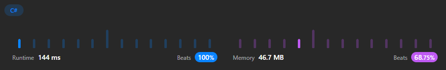

# C# BFS Solution with step by step approach. ❇️✅

**Author:** ArafatSabbir
**Votes:** 3
**Link:** [https://leetcode.com/problems/shortest-path-with-alternating-colors/solutions/3170377/](https://leetcode.com/problems/shortest-path-with-alternating-colors/solutions/3170377/)

---

# Approach
- Use BFS to find the shortest path.
- Use a queue to store the nodes and a hashset to store the visited nodes.
- Use a boolean to indicate the color of the node.
- Use a level variable to keep track of the level.
- Use a count variable to keep track of the number of nodes in the current level.
- Use a for loop to iterate through the nodes in the current level.
- Use a nested for loop to iterate through the edges of the current node.
- Use a nested if statement to check if the next node is visited. If it is not visited,
- Add it to the queue and the hashset. We can increment the level variable after the for loop.
- Return the result array.

# Space and Memory Graph



# Complexity
- Time complexity:
Time: O(n + e) where n is the number of nodes and e is the number of edges

- Space complexity:
Space: O(n + e)

    *where n is the number of nodes and e is the number of edges*

# Code
```
public class Solution
{
    public int[] ShortestAlternatingPaths(int n, int[][] redEdges, int[][] blueEdges)
    {
        var red = new List<int>[n];
        var blue = new List<int>[n];

        for (var i = 0; i < n; i++)
        {
            red[i] = new List<int>();
            blue[i] = new List<int>();
        }

        foreach (var edge in redEdges) red[edge[0]].Add(edge[1]);

        foreach (var edge in blueEdges) blue[edge[0]].Add(edge[1]);

        var result = new int[n];
        for (var i = 0; i < n; i++) result[i] = -1;

        var queue = new Queue<(int node, bool color)>();
        queue.Enqueue((0, true));
        queue.Enqueue((0, false));

        var visited = new HashSet<(int node, bool color)>();
        visited.Add((0, true));
        visited.Add((0, false));

        var level = 0;
        while (queue.Count > 0)
        {
            var count = queue.Count;
            for (var i = 0; i < count; i++)
            {
                var (node, color) = queue.Dequeue();
                if (result[node] == -1) result[node] = level;

                if (color)
                {
                    foreach (var next in red[node])
                        if (!visited.Contains((next, false)))
                        {
                            queue.Enqueue((next, false));
                            visited.Add((next, false));
                        }
                }
                else
                {
                    foreach (var next in blue[node])
                        if (!visited.Contains((next, true)))
                        {
                            queue.Enqueue((next, true));
                            visited.Add((next, true));
                        }
                }
            }

            level++;
        }

        return result;
    }
}
```

# Like \u2B06\uFE0F | Share \uD83C\uDFAF | Favourite \u2B50