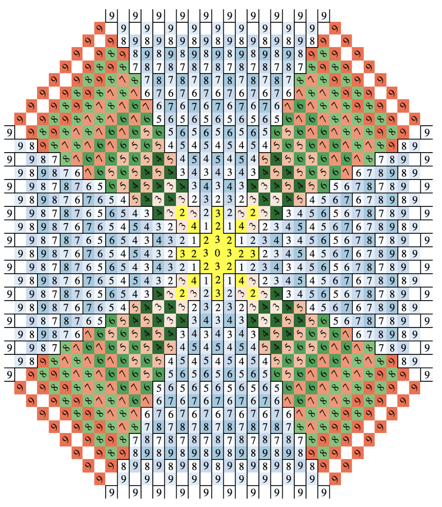

# Swift O(1) Solution with Visualization

**Author:** sghiassy
**Votes:** 2
**Link:** [https://leetcode.com/problems/minimum-knight-moves/solutions/739319/](https://leetcode.com/problems/minimum-knight-moves/solutions/739319/)

---

From this post: https://leetcode.com/problems/minimum-knight-moves/discuss/387036/O(1)-formula.

```
class Solution {
	func minKnightMoves(_ x: Int, _ y: Int) -> Int {
		var x = abs(x)
		var y = abs(y)
		
		if x < y {
			swap(&x, &y)
		}
		
		if x == 1 && y == 0 {
			return 3
		}
		
		if x == 2 && y == 2 {
			return 4
		}
		
		let delta = x - y
		
		if y > delta {
			return Int(Double(delta) - 2 * floor(Double(delta - y) / 3))
		} else {
			return Int(Double(delta) - 2 * floor((Double(delta - y) / 4)))
		}
	}
}
```

Also, see this jsFiddle someone created for help seeing the pattern: https://jsfiddle.net/graemian/5qgvr1ba/11/


