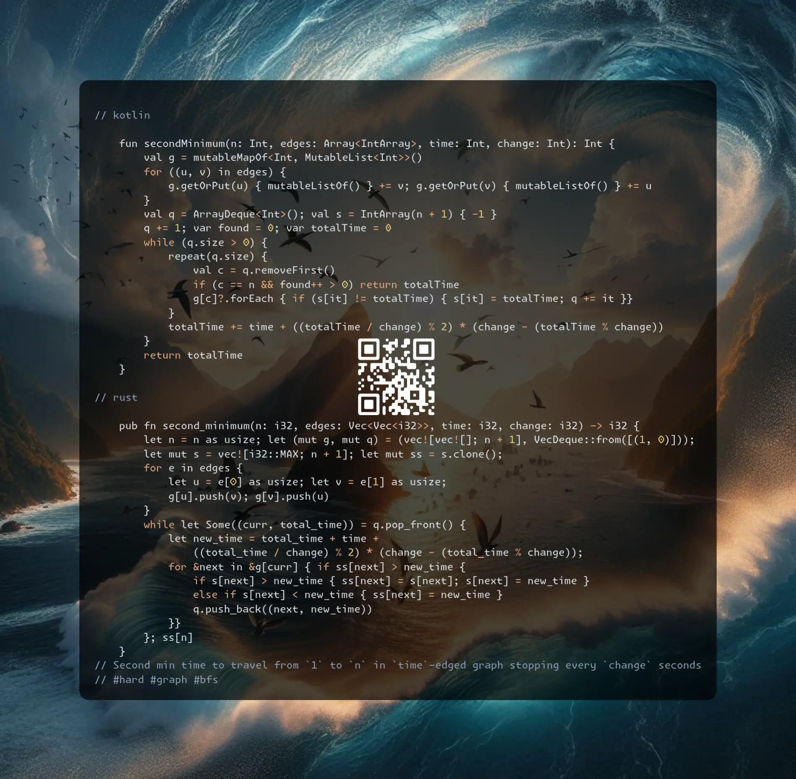

# Kotlin | Rust

**Author:** SamoylenkoDmitry
**Votes:** 1
**Link:** [https://leetcode.com/problems/second-minimum-time-to-reach-destination/solutions/5547657/](https://leetcode.com/problems/second-minimum-time-to-reach-destination/solutions/5547657/)

---



https://youtu.be/CcAep5fdevc

#### Join me on Telegram

https://t.me/leetcode_daily_unstoppable/684

#### Problem TLDR

Second min time to travel from `1` to `n` in `time`-edged graph stopping every `change` seconds #hard #graph #bfs

#### Intuition

Let's try to find the 2nd-shortest path with BFS. This solution will be accepted with a one optimization: remove the duplicate nodes from the queue.

Another way to think about the problem is to consider every (path & time) individually and keep track of the best and the 2nd best visited times for each node. Repeat BFS until there are no more improvements in the arrival times. 

#### Approach

Let's implement both the solutions.

#### Complexity

- Time complexity:
$$O((EV)^p)$$, for the naive BFS, p - second path length,
$$O(E + V^2)$$ or $$((E + V)log(V))$$ for PQ, like for the Dijkstra algorithm 

- Space complexity:
$$O(E + V)$$

#### Code

```kotlin []

    fun secondMinimum(n: Int, edges: Array<IntArray>, time: Int, change: Int): Int {
        val g = mutableMapOf<Int, MutableList<Int>>()
        for ((u, v) in edges) {
            g.getOrPut(u) { mutableListOf() } += v; g.getOrPut(v) { mutableListOf() } += u
        }
        val q = ArrayDeque<Int>(); val s = IntArray(n + 1) { -1 }
        q += 1; var found = 0; var totalTime = 0
        while (q.size > 0) {
            repeat(q.size) {
                val c = q.removeFirst()
                if (c == n && found++ > 0) return totalTime
                g[c]?.forEach { if (s[it] != totalTime) { s[it] = totalTime; q += it }}
            }
            totalTime += time + ((totalTime / change) % 2) * (change - (totalTime % change))
        }
        return totalTime
    }

```
```rust []

    pub fn second_minimum(n: i32, edges: Vec<Vec<i32>>, time: i32, change: i32) -> i32 {
        let n = n as usize; let (mut g, mut q) = (vec![vec![]; n + 1], VecDeque::from([(1, 0)]));
        let mut s = vec![i32::MAX; n + 1]; let mut ss = s.clone();
        for e in edges {
            let u = e[0] as usize; let v = e[1] as usize;
            g[u].push(v); g[v].push(u)
        }
        while let Some((curr, total_time)) = q.pop_front() {
            let new_time = total_time + time + 
                ((total_time / change) % 2) * (change - (total_time % change));
            for &next in &g[curr] { if ss[next] > new_time {
                if s[next] > new_time { ss[next] = s[next]; s[next] = new_time }
                else if s[next] < new_time { ss[next] = new_time }
                q.push_back((next, new_time))
            }}
        }; ss[n]
    }

```