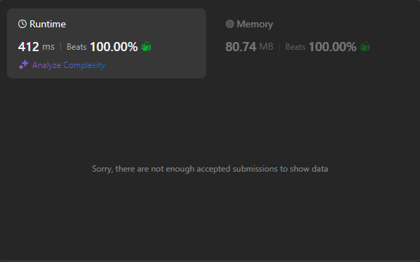

# 🔥100% Beats Runtime👌Easy Explanation💥Simple Solution🔥

**Author:** Ala-dine
**Votes:** 2
**Link:** [https://leetcode.com/problems/second-minimum-time-to-reach-destination/solutions/5547828/](https://leetcode.com/problems/second-minimum-time-to-reach-destination/solutions/5547828/)

---


# \u2705 Intuition
- #### \uD83D\uDCA5Graph Representation: Model the city as a graph with nodes and edges. Use Breadth-First Search (BFS) to find paths from the start node to the destination node.
- #### \uD83D\uDCA5Traffic Signals: Each node has a traffic signal that alternates every `change` minutes. You can only leave a node when the signal is green, potentially causing delays.
- #### \uD83D\uDCA5Second Shortest Path: Use BFS to explore paths and record the first and second times you reach each node. The second time you reach the destination node (`n`) is the second shortest path.
- #### \uD83D\uDCA5Time Calculation: When arriving at a node, check if you need to wait for a green signal before moving to the next node. Adjust the travel time accordingly to account for signal delays
# \u2705Approach
1. #### \uD83D\uDCA5Initialize Graph : Construct an adjacency list from the given edges to represent the graph.
2. #### \uD83D\uDCA5Use BFS : Perform a Breadth-First Search (BFS) starting from node 1 to explore all possible paths to node $n$
3. #### \uD83D\uDCA5Track Visit Times : Maintain a list of visit times for each node to record the first and second times each node is reached.
4. #### \uD83D\uDCA5Simulate Traffic Signals : For each path, calculate the time to traverse an edge. If the current time at a node falls within a red signal, wait until the signal turns green before moving.
5. #### \uD83D\uDCA5Find the Second Minimum : Track the time taken to reach node $n$ The first time gives the minimum time; the second time gives the second minimum time.
6. #### \uD83D\uDCA5Return the Result : Once node $n$ is reached for the second time, return that travel time as the result.
# \u2705Complexity
### \uD83D\uDD25Time complexity :
#### \uD83D\uDD25$O(V + E)$ : BFS visits each node and edge once, handling traffic signals in constant time.
### \uD83D\uDD25Space complexity :
#### \uD83D\uDD25Adjacency List : $O(E)$
#### \uD83D\uDD25BFS Queue and Visit Times : $O(V)$ 
# \u2705Code
``` typescript []
function secondMinimum(n: number, edges: number[][], time: number, change: number): number {
    const adj: number[][] = Array.from({ length: n + 1 }, () => []);

    for (const [v1, v2] of edges) {
        adj[v1].push(v2);
        adj[v2].push(v1);
    }

    const queue: number[] = [1];
    let curTime = 0;
    let res = -1;
    const visitTimes: number[][] = Array.from({ length: n + 1 }, () => []);

    while (queue.length > 0) {
        const levelSize = queue.length;
        for (let i = 0; i < levelSize; i++) {
            const node = queue.shift()!;

            if (node === n) {
                if (res !== -1) {
                    return curTime;
                }
                res = curTime;
            }

            for (const nei of adj[node]) {
                const neiTimes = visitTimes[nei];

                if (neiTimes.length === 0 || (neiTimes.length === 1 && neiTimes[0] !== curTime)) {
                    queue.push(nei);
                    neiTimes.push(curTime);
                }
            }
        }

        if (Math.floor(curTime / change) % 2 === 1) {
            curTime += change - (curTime % change);
        }

        curTime += time;
    }

    return -1;
}

```
``` javascript []
var secondMinimum = function(n, edges, time, change) {
            // Create an adjacency list for the graph
        const adj = Array.from({ length: n + 1 }, () => []);

        // Populate adjacency list with edges
        for (const [v1, v2] of edges) {
            adj[v1].push(v2);
            adj[v2].push(v1);
        }

        // Initialize queue for BFS and track visited times
        const queue = [1];
        let curTime = 0;
        let res = -1;
        const visitTimes = Array.from({ length: n + 1 }, () => []);

        // BFS traversal
        while (queue.length > 0) {
            const levelSize = queue.length;
            for (let i = 0; i < levelSize; i++) {
                const node = queue.shift();

                // Check if we've reached the destination node
                if (node === n) {
                    if (res !== -1) {
                        return curTime;
                    }
                    res = curTime;
                }

                // Explore neighbors
                for (const nei of adj[node]) {
                    const neiTimes = visitTimes[nei];

                    // Check if the neighbor can be visited
                    if (neiTimes.length === 0 || (neiTimes.length === 1 && neiTimes[0] !== curTime)) {
                        queue.push(nei);
                        visitTimes[nei].push(curTime);
                    }
                }
            }

            // Handle traffic signals (wait for green light if needed)
            if (Math.floor(curTime / change) % 2 === 1) {
                curTime += change - (curTime % change);
            }

            // Increase current time by the edge traversal time
            curTime += time;
        }

        return -1; // Return -1 if the second minimum path is not found (should not happen with given problem constraints)

};
```
``` java []
import java.util.*;

public class Solution {
    public int secondMinimum(int n, int[][] edges, int time, int change) {
        // Initialize adjacency list for the graph
        List<List<Integer>> adj = new ArrayList<>();
        for (int i = 0; i <= n; i++) {
            adj.add(new ArrayList<>());
        }

        // Populate adjacency list with edges
        for (int[] edge : edges) {
            int v1 = edge[0];
            int v2 = edge[1];
            adj.get(v1).add(v2);
            adj.get(v2).add(v1);
        }

        // BFS initialization
        Queue<Integer> queue = new LinkedList<>();
        queue.offer(1);
        int curTime = 0;
        int res = -1;
        
        // Initialize visit times for each node
        List<List<Integer>> visitTimes = new ArrayList<>();
        for (int i = 0; i <= n; i++) {
            visitTimes.add(new ArrayList<>());
        }
        visitTimes.get(1).add(0);

        // BFS traversal
        while (!queue.isEmpty()) {
            int levelSize = queue.size();
            for (int i = 0; i < levelSize; i++) {
                int node = queue.poll();

                // Check if we've reached the destination node
                if (node == n) {
                    if (res != -1) {
                        return curTime;
                    }
                    res = curTime;
                }

                // Explore neighbors
                for (int nei : adj.get(node)) {
                    List<Integer> neiTimes = visitTimes.get(nei);

                    // Check if the neighbor can be visited
                    if (neiTimes.isEmpty() || (neiTimes.size() == 1 && !neiTimes.contains(curTime))) {
                        queue.offer(nei);
                        neiTimes.add(curTime);
                    }
                }
            }

            // Handle traffic signals (wait for green light if needed)
            if ((curTime / change) % 2 == 1) {
                curTime += change - (curTime % change);
            }

            // Increase current time by the edge traversal time
            curTime += time;
        }

        return -1; // Return -1 if the second minimum path is not found
    }
}

```