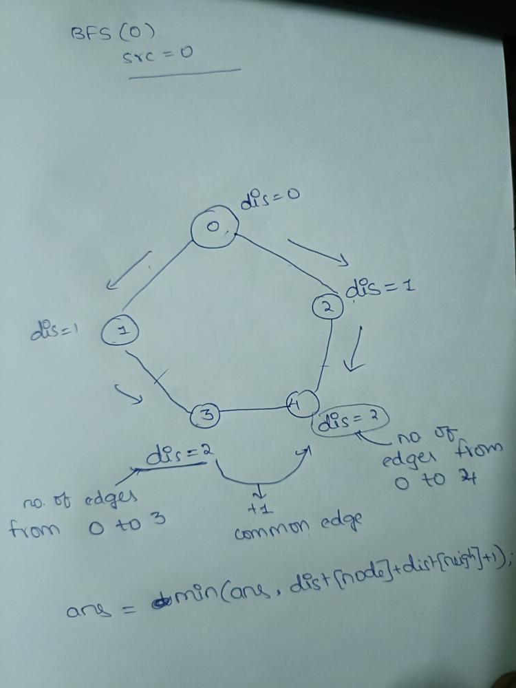

# INTUITIVE APPROACH |  BFS| Clean code | C++ |😎

**Author:** Naser_ali
**Votes:** 78
**Link:** [https://leetcode.com/problems/shortest-cycle-in-a-graph/solutions/3366629/](https://leetcode.com/problems/shortest-cycle-in-a-graph/solutions/3366629/)

---



at every vertex we are checking for shortest cycle
Using BFS 
```
class Solution
{
public:
    
    int ans = INT_MAX;

    void bfs(int src,vector<int> adj[],int n){
            vector<int> distance(n,(1e9));
            vector<int> parent(n, -1);
            
            queue<int> q;
            distance[src] = 0;
            q.push(src);
            while (!q.empty()) {
                int node = q.front();
                q.pop();
                for (auto neigh : adj[node]) {
                    if (distance[neigh] == (int)(1e9)) {
                        distance[neigh] = 1 + distance[node];
                        parent[neigh] = node;
                        q.push(neigh);
                }
                else if (parent[node] != neigh && parent[neigh] != node)
                    ans = min(ans, distance[neigh] + distance[node] + 1);
                }
            }
    }
    int findShortestCycle(int n, vector<vector<int>> &edges)
    {

        vector<int> adj[n + 1];
        for (auto it : edges)
        {
            int u = it[0];
            int v = it[1];
            adj[u].push_back(v);
            adj[v].push_back(u);
        }
      
        for (int i = 0; i < n; i++)
        {
            bfs(i,adj,n);
        }
        if (ans == INT_MAX)
            return -1;
        return ans;
    }
};


upvote if found usefull
 Thanks for visiting my solution.\uD83D\uDE0A Keep Learning


