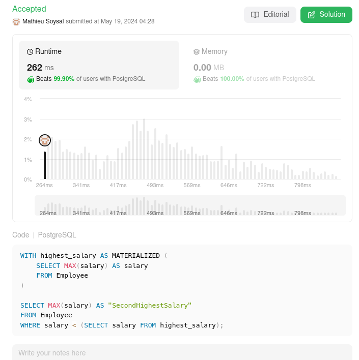

# 🌟 Explained performand PostgreSQL solution 🚀 Beats 99%+ 🌠

**Author:** MathieuSoysal
**Votes:** 47
**Link:** [https://leetcode.com/problems/second-highest-salary/solutions/5040686/](https://leetcode.com/problems/second-highest-salary/solutions/5040686/)

---



# Explanation

- `WITH highest_salary AS (...)`: This is the CTE part of the query. It creates a temporary result set named *highest_salary* that is used in the subsequent SELECT statement. The CTE calculates the maximum salary from the Employee table and labels it as salary.

- `SELECT MAX(salary) AS "SecondHighestSalary" FROM Employee WHERE salary < (SELECT salary FROM highest_salary)`: This is the main query that uses the result of the CTE. It selects the maximum salary from the Employee table where the salary is less than the highest salary found in the CTE. This effectively gives you the second highest salary because it excludes the highest salary from the calculation.


## What is performand in this query

- **Not using ORDER BY clause**
    - `ORDER BY` clause, is an expensive clause. The cost of this is $$O(n log(n))$$ 
- **Saving subquery with CTE**
    - Utility of CTE it's saving the result of subquery `SELECT MAX(salary) FROM Employee` and avoid execution of `MAX` function each time

# Code
``` PostgreSQL []
WITH highest_salary AS (
    SELECT MAX(salary) AS salary
    FROM Employee
)

SELECT MAX(salary) AS "SecondHighestSalary" 
FROM Employee
WHERE salary < (SELECT salary FROM highest_salary);
```
``` Oracle []
WITH highest_salary AS (
    SELECT MAX(salary) AS salary
    FROM Employee
)
SELECT MAX(salary) AS "SecondHighestSalary"
FROM Employee
WHERE salary < (SELECT salary FROM highest_salary);
```
``` MySQL []
WITH highest_salary AS (
    SELECT MAX(salary) AS salary
    FROM Employee
)
SELECT MAX(salary) AS SecondHighestSalary
FROM Employee
WHERE salary < (SELECT salary FROM highest_salary);
```
``` MSSQL []
WITH highest_salary AS (
    SELECT MAX(salary) AS salary
    FROM Employee
)
SELECT MAX(salary) AS SecondHighestSalary
FROM Employee
WHERE salary < (SELECT salary FROM highest_salary);
```
____

If it was useful don't hesitate to upvote \uD83C\uDF20 Or keep it in your favorite \uD83C\uDF1F
