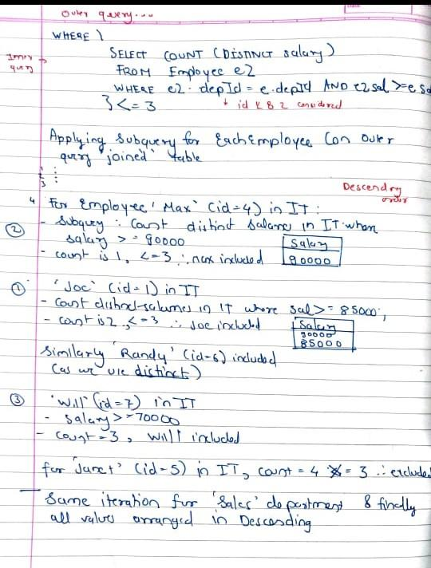

# ✅Easiest Basic Sql Solution |3 Approaches| Beginner Level to Advance🏆

**Author:** dev_yash_
**Votes:** 63
**Link:** [https://leetcode.com/problems/department-top-three-salaries/solutions/5367303/](https://leetcode.com/problems/department-top-three-salaries/solutions/5367303/)

---

#### Approach 1: Basic 
```
--My SQL
SELECT
    d.name AS Department,
    e.name AS Employee,
    e.salary AS Salary
FROM
    Employee e
    JOIN Department d ON e.departmentId = d.id
WHERE
    (
        SELECT COUNT(DISTINCT salary)
        FROM Employee e2
        WHERE e2.departmentId = e.departmentId AND e2.salary >= e.salary
    ) <= 3
ORDER BY
    Department, Salary DESC;

```
#### Approach 2
```
--ms sql server
SELECT
    d.name AS Department,
    e.name AS Employee,
    e.salary AS Salary
FROM
    Department d
    JOIN Employee e ON d.id = e.departmentId
WHERE
    e.salary IN (
        SELECT DISTINCT TOP 3 salary
        FROM Employee e2
        WHERE e2.departmentId = d.id
        ORDER BY salary DESC
    )
ORDER BY
    Department, Salary DESC;
	
```
Subquery Iteration:



	


#### Approach 3: Window+DENSE RANK
```
--ms sql server
WITH helper AS
(
    SELECT 
        E.name Employee, 
        E.salary Salary,
        D.name Department,
        DENSE_RANK() OVER (PARTITION BY D.id ORDER BY salary DESC) rank
    FROM Employee E JOIN Department D
    ON D.id = E.departmentId
)
SELECT 
    Employee, 
    Salary,
    Department
FROM helper
WHERE rank < 4;
```


##### **STAY COOL STAY DISCIPLINED..!**

