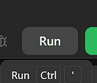

# ✅ REAL explained step by step ✅9/50 | All SQL50

**Author:** Piotr_Maminski
**Votes:** 208
**Link:** [https://leetcode.com/problems/rising-temperature/solutions/5884157/](https://leetcode.com/problems/rising-temperature/solutions/5884157/)

---


```mysql []
SELECT today.id
FROM Weather yesterday 
CROSS JOIN Weather today

WHERE DATEDIFF(today.recordDate,yesterday.recordDate) = 1
    AND today.temperature > yesterday.temperature
;
```
```mssql [MS SQL Server]
SELECT today.id
FROM Weather yesterday
CROSS JOIN Weather today

WHERE DATEDIFF(DAY, yesterday.recordDate, today.recordDate) = 1
    AND today.temperature > yesterday.temperature
;
```
```oraclesql [Oracle]
SELECT today.id 
FROM Weather yesterday
CROSS JOIN Weather today

WHERE today.recorddate - yesterday.recorddate = 1
    AND today.temperature > yesterday.temperature 
;
```
```postgresql [PostgreSQL]
SELECT today.id 
FROM Weather yesterday
CROSS JOIN Weather today

WHERE today.recorddate - yesterday.recorddate = 1
    AND today.temperature > yesterday.temperature 
;
```
```pythondata [Pandas]
# Time: O(n log n) , Space: O(n) 
import pandas as pd

def rising_temperature(weather: pd.DataFrame) -> pd.DataFrame:
    weather.sort_values(by='recordDate', inplace=True)
    return weather[
        (weather.temperature.diff() > 0)
      & (weather.recordDate.diff().dt.days == 1)
    ][['id']]
```


# Step by Step

We want to find a day that is hotter than the previous day(yesterday).

To do this, we first need to create every possible combination of days and "place" them side by side.

So we will join the same table with itself.

We're going to use a CROSS JOIN (Cartesian product)

which is like making every possible pair of rows from two tables.


```
SELECT *
FROM Weather yesterday
CROSS JOIN Weather today
```


Output:
```
| id | recordDate | temperature | id | recordDate | temperature |
| -- | ---------- | ----------- | -- | ---------- | ----------- |
| 4  | 2015-01-04 | 30          | 1  | 2015-01-01 | 10          |
| 3  | 2015-01-03 | 20          | 1  | 2015-01-01 | 10          |
| 2  | 2015-01-02 | 25          | 1  | 2015-01-01 | 10          |
| 1  | 2015-01-01 | 10          | 1  | 2015-01-01 | 10          |
| 4  | 2015-01-04 | 30          | 2  | 2015-01-02 | 25          |
| 3  | 2015-01-03 | 20          | 2  | 2015-01-02 | 25          |
| 2  | 2015-01-02 | 25          | 2  | 2015-01-02 | 25          |
| 1  | 2015-01-01 | 10          | 2  | 2015-01-02 | 25          |
| 4  | 2015-01-04 | 30          | 3  | 2015-01-03 | 20          |
| 3  | 2015-01-03 | 20          | 3  | 2015-01-03 | 20          |
| 2  | 2015-01-02 | 25          | 3  | 2015-01-03 | 20          |
| 1  | 2015-01-01 | 10          | 3  | 2015-01-03 | 20          |
```

Now we'll narrow down results to pairs of consecutive days.

```
WHERE DATEDIFF(today.recordDate,yesterday.recordDate) = 1
```


Wait... but why are the days in reverse order? Yesterday is after today?

Well, DATEDIFF (in MySQL) treats the first date as the end date. 

In MS SQL Sever is opposite :)

Strange, I know, but you have to remember it as subtracting DATA1 - DATA2.


Alternative option is:

```
WHERE DATEDIFF(yesterday.recordDate,today.recordDate,) = - 1
```

Carrying on...

We get:

```
| id | recordDate | temperature | id | recordDate | temperature |
| -- | ---------- | ----------- | -- | ---------- | ----------- |
| 1  | 2015-01-01 | 10          | 2  | 2015-01-02 | 25          |
| 2  | 2015-01-02 | 25          | 3  | 2015-01-03 | 20          |
| 3  | 2015-01-03 | 20          | 4  | 2015-01-04 | 30          |
```

Now, we just need to add a condition to check if today temperature is higher than yesterday

```
WHERE DATEDIFF(today.recordDate,yesterday.recordDate) = 1
    AND today.temperature > yesterday.temperature
``` 
Output:
```
| id | recordDate | temperature | id | recordDate | temperature |
| -- | ---------- | ----------- | -- | ---------- | ----------- |
| 1  | 2015-01-01 | 10          | 2  | 2015-01-02 | 25          |
| 3  | 2015-01-03 | 20          | 4  | 2015-01-04 | 30          |
```

One last thing, `SELECT today.id` 

Final code:
```mysql []
SELECT today.id
FROM Weather yesterday 
CROSS JOIN Weather today

WHERE DATEDIFF(today.recordDate,yesterday.recordDate) = 1
    AND today.temperature > yesterday.temperature
```

I put a lot of work into it, so pretty please with sugar on top...


