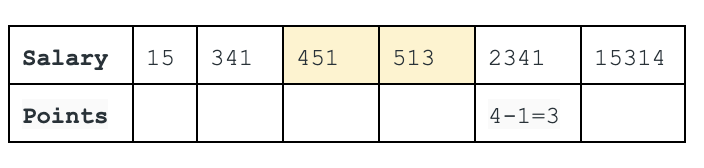
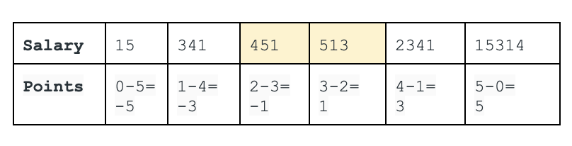
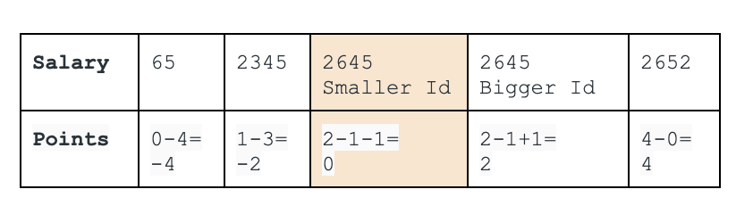

# (^_^) MySQL Solutions: WINDOW / Follow-up + Explanation using Sub-query

**Author:** 120668385
**Votes:** 11
**Link:** [https://leetcode.com/problems/median-employee-salary/solutions/703795/](https://leetcode.com/problems/median-employee-salary/solutions/703795/)

---

CHOICE 1: USING WINDOW FUNCTION
```
with t1 as(
    select *, 
        rank()over(partition by Company order by Salary,Id) rk
    from Employee), t2 as(
    select Company, avg(rk) as avg_rk
    from t1
    group by Company
    )

select t1.Id,
    t1.Company,
    t1.Salary
from t1 join t2 on t1.Company = t2.Company
where abs(t1.rk - t2.avg_rk) < 1
```

CHOICE 2: using Sub-query to solve the follow-up question
```
SELECT e1.Id, e1.Company, e1.Salary
FROM employee e1 
JOIN employee e2 
ON e1.Company = e2.Company
GROUP BY e1.id, e1.company, e1.Salary
HAVING abs(
    SUM(CASE 
            WHEN e2.Salary >  e1.Salary THEN 1
			WHEN e2.Salary < e1.Salary THEN -1
            WHEN e2.Salary = e1.Salary AND e2.Id > e1.Id THEN 1
            WHEN e2.Salary = e1.Salary AND e2.Id < e1.Id THEN -1
			ELSE 0 END)
          )<=1
ORDER by e1.id, e1.Company, e1.Salary;
```

# Explanations:

First, using the following code to join the two same employee tables
```
SELECT *,
CASE 
            WHEN e2.Salary >  e1.Salary THEN 1
			WHEN e2.Salary < e1.Salary THEN -1
            WHEN e2.Salary = e1.Salary AND e2.Id > e1.Id THEN 1
            WHEN e2.Salary = e1.Salary AND e2.Id < e1.Id THEN -1
			ELSE 0 END as Points
FROM employee e1 
JOIN employee e2 
ON e1.Company = e2.Company
```

Then calculate how many points each salary worth.

For company A:


Explanation\uFF1A e2.Salary(2341) is greater than 4 salaries (15,341,451,513) and smaller than 1 salary(15314)
Points: (+4) + (-1)= 3

Similarly, e2.Salary(513) is greater than 3 salaries (15,341,451) and smaller than 2 salaries (2341,15314)
Points: (+3) + (-2) = 1


For company C:


Explanation: e2.salary(2645 with smaller Id) is greater than 2 salaries(65, 2345) and smaller than 1 salary(2652). What\u2019s more, it is equal to 1 salary (2645 with bigger Id) so this bigger id\u2019s salary is located as a \u2018bigger salary\u2019, which is included into the total 2 salaries that e2.salary(2645) is smaller than.
Points: (+2) + (-2) = 0

Similarly, e2.salary(2645 with bigger Id) gets the Points: (+3)+(-1) = 2

Finally, you find out that only salaries that have Points <=1 are the median salary of each company. 


