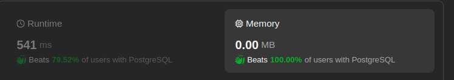

# Memory Beats 100.00% of users with PostgreSQL

**Author:** Javohir_hasanov
**Votes:** 5
**Link:** [https://leetcode.com/problems/managers-with-at-least-5-direct-reports/solutions/5091718/](https://leetcode.com/problems/managers-with-at-least-5-direct-reports/solutions/5091718/)

---

image.png

# Code
```
SELECT name FROM Employee
WHERE id in (select managerId from employee group by managerId having count(id) >= 5);
```