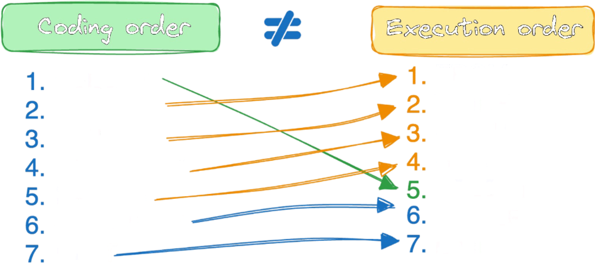

# ✅2/50 | All SQL50 Explained

**Author:** Piotr_Maminski
**Votes:** 10
**Link:** [https://leetcode.com/problems/find-customer-referee/solutions/5833692/](https://leetcode.com/problems/find-customer-referee/solutions/5833692/)

---


```mysql [MySQL]
SELECT name
FROM Customer
WHERE COALESCE(referee_id,0) != 2
;
```
```mssql [MS SQL Server]
SELECT name
FROM Customer
WHERE COALESCE(referee_id,0) != 2
;
```
```oraclesql [Oracle]
SELECT name
FROM Customer
WHERE COALESCE(referee_id,0) != 2
;
```
```postgresql [PostgreSQL]
SELECT name
FROM Customer
WHERE COALESCE(referee_id,0) != 2
;
```
```pythondata [Pandas]
import pandas as pd

def find_customer_referee(customer: pd.DataFrame) -> pd.DataFrame:
    customer = customer[(customer['referee_id'].isnull()) | (customer['referee_id'] != 2)][['name']]
    return customer
```
COALESCE is supported by all SQL systems, unlike IFFNULL which is specific to MySQL
# EXPLAINED
- **COALESCE(referee_id, 0) != 2**
The COALESCE function checks each row\u2019s referee_id:
If referee_id is NULL, it substitutes 0.
It then compares the result to 2.
Only rows where the result is **not** equal to 2 are included in the result set.
# Order of Execution 

**FROM** Customer > **WHERE** COALESCE(referee_id, 0) != 2 > **SELECT** name



