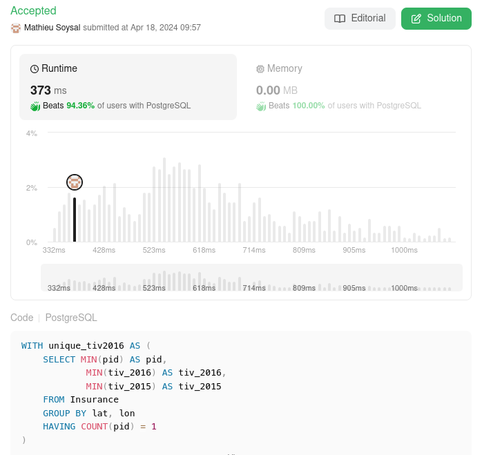

# 🌟 Explained perfomand PostgreSQL solution 🚀 Beats 94%+ 🌠

**Author:** MathieuSoysal
**Votes:** 12
**Link:** [https://leetcode.com/problems/investments-in-2016/solutions/5040471/](https://leetcode.com/problems/investments-in-2016/solutions/5040471/)

---




# Explaination


- **CTE - unique_tiv2016**:

    - The CTE named *unique_tiv2016* is created to select unique records from the Insurance table based on the combination of latitude (`lat`) and longitude (`lon`).
    - It groups the records by `lat` and `lon`, which suggests that each unique geographic location is being considered.
    - The `HAVING COUNT(pid) = 1` clause ensures that only those groups with exactly one policy ID (`pid`) are selected, meaning it filters for unique locations where only one insurance policy is present.
    - For each of these unique locations, the CTE selects the minimum `pid`, `tiv_2016`, and `tiv_2015`. The use of `MIN` here is a bit unconventional since we're already guaranteed to have only one pid per group due to the `HAVING` clause, but it's necessary to use an aggregate function because of the `GROUP BY`.

- **Main SELECT Statement**:
    - The main query calculates the sum of the `tiv_2016` values from the *unique_tiv2016* CTE.
    - It rounds the sum to two decimal places and aliases it as `tiv_2016`.
    - The `WHERE EXISTS` clause is used to filter the results further. It checks for the existence of at least one row in the original `Insurance` table (i) where the `pid` is different from the `pid` in the CTE (`t1.pid`) and the `tiv_2015` value is the same as in the CTE (`t1.tiv_2015`).


## What is performand in this query

- **Minizing table size before JOIN**:
    - with the CTE *unique_tiv2016* we have minimized the size of the table and made the join more performand
- **Usage of EXISTS instead of IN or a JOIN**:
    - The `EXISTS` clause can be efficient than `IN` or `JOIN` because it stops searching as soon as it finds a match. 
- **Minimizing the number of expensive clause like GROUP BY, JOIN or IN**
    - in this query we have only one `GROUP BY`, zero `IN` and zero `JOIN`  


# Code
```
WITH unique_tiv2016 AS (
    SELECT MIN(pid) AS pid,
            MIN(tiv_2016) AS tiv_2016,
            MIN(tiv_2015) AS tiv_2015
    FROM Insurance
    GROUP BY lat, lon
    HAVING COUNT(pid) = 1
)

SELECT ROUND(SUM(t1.tiv_2016)::decimal, 2) AS tiv_2016
FROM unique_tiv2016 AS t1
WHERE EXISTS (
            SELECT 1
            FROM Insurance AS i
            WHERE i.pid != t1.pid
                AND i.tiv_2015 = t1.tiv_2015);
```

____

If it was useful don't hesitate to upvote \uD83C\uDF20 Or keep it in your favorite \uD83C\uDF1F
