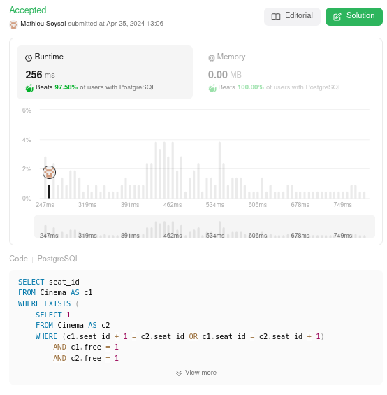

# 🌟 Well explained performand PostgreSQL solution without using IN or JOIN  🚀 Beats 97% 🌠

**Author:** MathieuSoysal
**Votes:** 1
**Link:** [https://leetcode.com/problems/consecutive-available-seats/solutions/5017009/](https://leetcode.com/problems/consecutive-available-seats/solutions/5017009/)

---



# Explain


- `WHERE EXISTS ( ... )`
    - The `WHERE EXISTS` clause is used to filter the results. It checks if a subquery returns any rows. If it does, the condition is true, and the `seat_id` from `c1` is included in the output.

- `SELECT 1 FROM Cinema AS c2`
    - Inside the `EXISTS`, we have another `SELECT` statement. This is the subquery that checks for the existence of certain conditions. The `SELECT 1` is a common pattern used in `EXISTS` subqueries because we don't care about the actual data returned; we only care if at least one row exists that meets the conditions. The Cinema table is referenced again with a different alias `c2`.

- `WHERE (c1.seat_id + 1 = c2.seat_id OR c1.seat_id = c2.seat_id + 1)`
    - This condition in the subquery checks for adjacent seats. It compares the `seat_id` from the outer query (`c1`) with the `seat_id` from the subquery (`c2`). There are two parts to this condition:

    - `c1.seat_id + 1 = c2.seat_id`: This checks if the seat in the outer query (`c1`) is immediately before a free seat in the subquery (`c2`).
    - `c1.seat_id = c2.seat_id + 1`: This checks if the seat in the outer query (`c1`) is immediately after a free seat in the subquery (`c2`).

    - These conditions ensure that only seats that are next to each other are considered.

    - `AND c1.free = 1 AND c2.free = 1` : In addition to checking if the seats are adjacent, this part of the subquery's `WHERE` clause also checks that both seats are free. The free column presumably has a value of `1` if a seat is free and `0` if it is not. Both `c1` and `c2` must have their free column set to `1` for the condition to be true.


## What is performand in this query

- **Don't use expensive operation**
    - We don't have any expensive clause like `IN`, `NOT IN`, `JOIN`, `GROUP BY`.
- **Usage of EXISTS clause**
    - `EXISTS` is in most case a efficient clause beceause it don't check all record once one record valid condition, it stop searching. For example `JOIN` continue searching even if codition was validate with one record.

- **Dont use DISTINCT**
    - Beceause we use `EXISTS` we dont don't need to use additionnal calculation cost with `DISTINCT`function  

# Code
``` PostgreSQL []
SELECT seat_id
FROM Cinema AS c1
WHERE EXISTS (
    SELECT 1
    FROM Cinema AS c2
    WHERE (c1.seat_id + 1 = c2.seat_id OR c1.seat_id = c2.seat_id + 1) 
        AND c1.free = 1
        AND c2.free = 1
)
ORDER BY seat_id;
```
``` MySQL []
SELECT seat_id
FROM Cinema AS c1
WHERE EXISTS (
    SELECT 1
    FROM Cinema AS c2
    WHERE (c1.seat_id + 1 = c2.seat_id OR c1.seat_id = c2.seat_id + 1) 
        AND c1.free = 1
        AND c2.free = 1
)
ORDER BY seat_id;
```