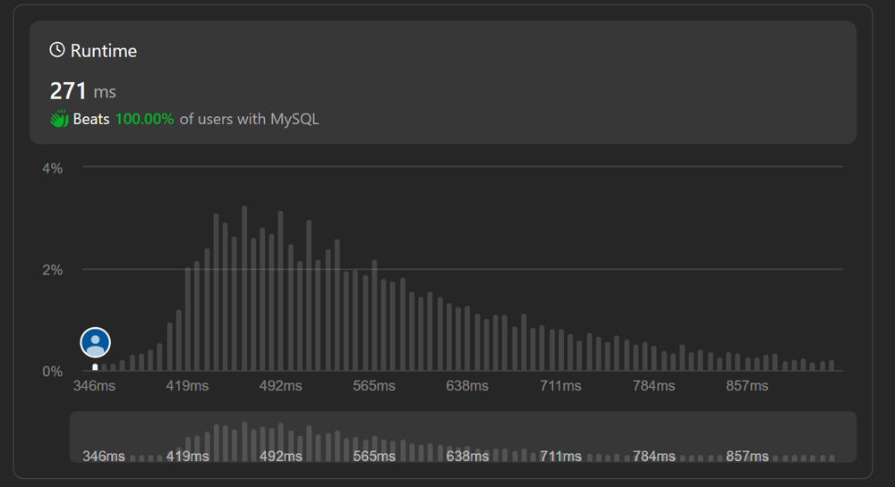

# ✅Triangle Judgement ||💯 Easy Solution ||😎 With explanation || 😍100% RUNTIME

**Author:** IamHazra
**Votes:** 16
**Link:** [https://leetcode.com/problems/triangle-judgement/solutions/4002638/](https://leetcode.com/problems/triangle-judgement/solutions/4002638/)

---




```
# Write your MySQL query statement below
select x,y,z,case when(x+y>z and x+z>y and y+z>x) then 'Yes' else 'No' end as triangle from triangle;
```
`MySQL`   `ORACLE`

`EXPLAINATION:-`
1. `select x, y, z, ...`: This part of the query selects the columns `x`, `y`, and `z` from a table named `triangle`. Presumably, the `triangle` table contains data related to triangles, and you want to check if certain combinations of `x`, `y`, and `z` form valid triangles.

2. `case when (x + y > z and x + z > y and y + z > x) then 'Yes' else 'No' end as triangle`: This part of the query calculates whether the given values of `x`, `y`, and `z` satisfy the triangle inequality theorem. The theorem states that for a set of side lengths to form a valid triangle, the sum of the lengths of any two sides must be greater than the length of the remaining side.

   - If `(x + y > z and x + z > y and y + z > x)` evaluates to `true`, it means the values form a valid triangle, so `'Yes'` is assigned as the value of the `triangle` column.
   - If the condition is `false`, it means the values do not form a valid triangle, so `'No'` is assigned as the value of the `triangle` column.

3. `from triangle`: This specifies the table from which the data is being selected, which is named `triangle`.

In summary, the query checks whether the given values of `x`, `y`, and `z` in the `triangle` table can form a valid triangle according to the triangle inequality theorem. If they can form a triangle, it assigns `'Yes'` to the `triangle` column; otherwise, it assigns `'No'`. The result set will include the original values of `x`, `y`, and `z` along with the calculated `triangle` column.

`Thank you` \uD83D\uDE4F

`Please upvote me if it useful for you`

`If you have any quary code or explanation related you can ask me in comment section.`

`Good Bye`\uD83D\uDC4B,`Have a Good Day.`