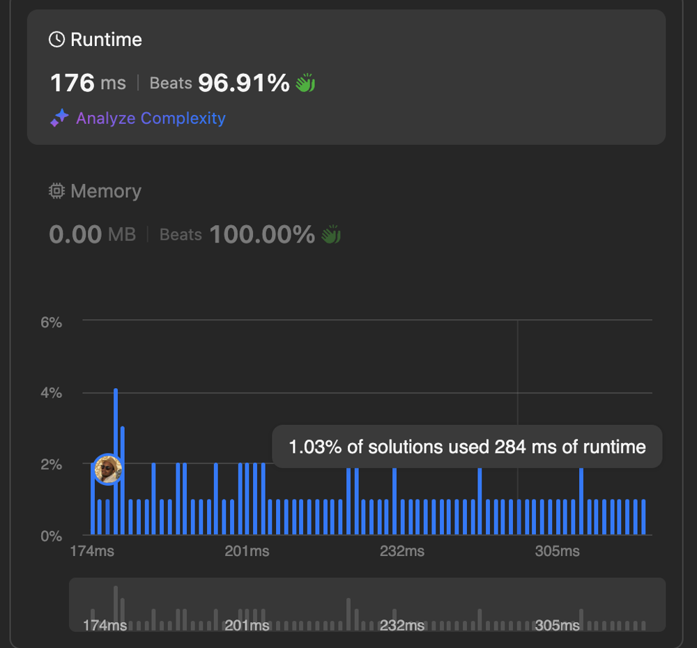

# window function + cte

**Author:** _jhowlett_
**Votes:** 1
**Link:** [https://leetcode.com/problems/average-salary-departments-vs-company/solutions/5680364/](https://leetcode.com/problems/average-salary-departments-vs-company/solutions/5680364/)

---




# Code
```postgresql []
-- Write your PostgreSQL query statement below
with cte as (
    select
        department_id,
        to_char(pay_date::date, 'YYYY-MM') as pay_month,
        avg(amount) over (partition by to_char(pay_date::date, 'YYYY-MM')) as avg_company_salary,
        avg(amount) over (partition by department_id, to_char(pay_date::date, 'YYYY-MM')) as avg_dept_salary
    from salary
    join employee on salary.employee_id = employee.employee_id
)

select
    distinct pay_month,
    department_id,
    case
        when avg_company_salary = avg_dept_salary then 'same'
        when avg_company_salary > avg_dept_salary then 'lower'
        when avg_company_salary < avg_dept_salary then 'higher'
    end as comparison
from cte
order by pay_month desc
```