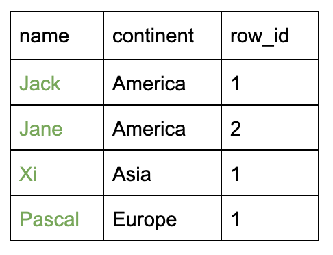
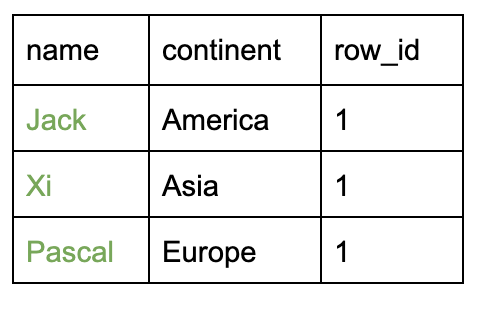
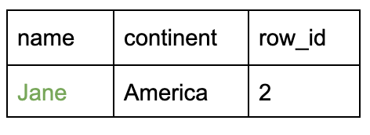
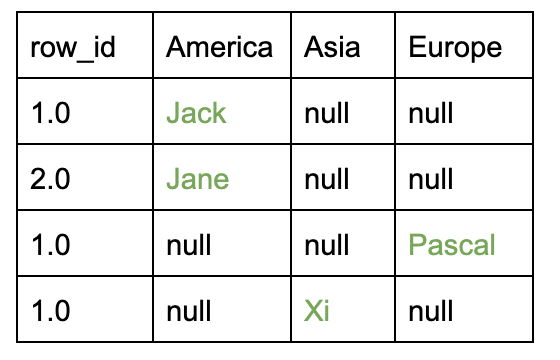

# (^_^) MySQL Solutions: WINDOW / variables (Follow-up answer)

**Author:** 120668385
**Votes:** 147
**Link:** [https://leetcode.com/problems/students-report-by-geography/solutions/672308/](https://leetcode.com/problems/students-report-by-geography/solutions/672308/)

---

You need to understand:
1. How to generate a useful row_id (using ROW_NUMBER() window function? or using Variables?)
2. GROUP BY row_id
3. CASE clause 
3. MAX function can consider only non-null values
________________________________
# CHOICE 1: using WINDOW function
```
SELECT
        MAX(CASE WHEN continent = 'America' THEN name END )AS America,
        MAX(CASE WHEN continent = 'Asia' THEN name END )AS Asia,
        MAX(CASE WHEN continent = 'Europe' THEN name END )AS Europe  
FROM (SELECT *, ROW_NUMBER()OVER(PARTITION BY continent ORDER BY name) AS row_id FROM student) AS t
GROUP BY row_id
```
**Explanation**:
In order to get the following table, you need to write a query like this
```
SELECT *, ROW_NUMBER()OVER(PARTITION BY continent ORDER BY name) AS row_id FROM student
```

Using GROUP BY to group rows with same row_id

*For example row_id = 1:*

*For example row_id = 2:*

After GROUP BY, using CASE function to get each continent's data, and **using MAX function to get all of the non-null values**.

***************************************************
# CHOICE 2: using variables
```
SELECT MAX(America) AS America, MAX(Asia) as Asia, MAX(Europe) AS Europe
FROM (
	SELECT 
        CASE WHEN continent = 'America' THEN @r1 := @r1 + 1
             WHEN continent = 'Asia'    THEN @r2 := @r2 + 1
             WHEN continent = 'Europe'  THEN @r3 := @r3 + 1 END row_id,
        CASE WHEN continent = 'America' THEN name END America,
        CASE WHEN continent = 'Asia'    THEN name END Asia,
        CASE WHEN continent = 'Europe'  THEN name END Europe
    FROM student, (SELECT @r1 := 0, @r2 := 0, @r3 := 0) tmp
    ORDER BY name) t
GROUP BY row_id;
```
**Explanation**:
Get a revised table with row_id like this:
```
SELECT 
        CASE WHEN continent = 'America' THEN @r1 := @r1 + 1
             WHEN continent = 'Asia'    THEN @r2 := @r2 + 1
             WHEN continent = 'Europe'  THEN @r3 := @r3 + 1 END row_id,
        CASE WHEN continent = 'America' THEN name END America,
        CASE WHEN continent = 'Asia'    THEN name END Asia,
        CASE WHEN continent = 'Europe'  THEN name END Europe
FROM student, (SELECT @r1 := 0, @r2 := 0, @r3 := 0) tmp
ORDER BY name
```

Using **GROUP BY** and **MAX** to get the final result, which is same as the explanation of CHOICE 1.