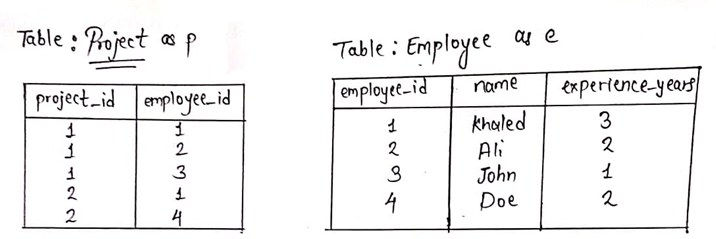
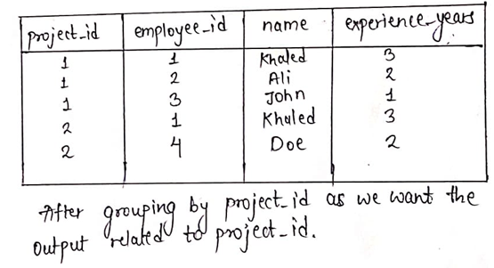
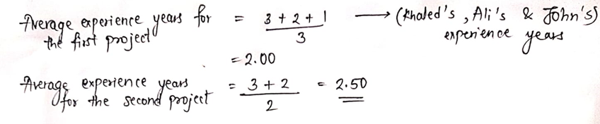
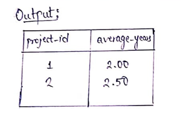

# 🚀BEATS 100% (Memory) 🚀 | | 🔥EASY MySQL Solution 🔥 | | ✅ ROUND, AVG, LEFT JOIN, GROUP BY ✅

**Author:** bhushanpakhle12
**Votes:** 703
**Link:** [https://leetcode.com/problems/project-employees-i/solutions/3876372/](https://leetcode.com/problems/project-employees-i/solutions/3876372/)

---

# Intuition
<!-- Describe your first thoughts on how to solve this problem. -->
We need to join the tables as the experience_years column is not directly related to project_id.

# Approach
<!-- Describe your approach to solving the problem. -->
As seen from the given input and output from the example, the second column in the output called average_years is calculated using the data of the column named experience_years.
Since we want the average experience years of all the employees project wise, we will need the experience years correlating to the project_id, but it is not given directly in the problem description.
So we will use the JOIN Operation to join the tables so that we can have the experience_years related to the project_id with the help of the employee_id column.
If you didn't understand it, don't worry; I will explain it to you step by step.


The table we get after using :
```
FROM Project p LEFT JOIN Employee e
ON p.employee_id = e.employee_id
```

We will then be using the GROUP BY operation :
```
GROUP BY p.project_id
```
As we use the 'GROUP BY' operation the average will be calculated automatically as shown below.




# Code
```
# Write your MySQL query statement below
SELECT p.project_id, ROUND(AVG(e.experience_years),2) AS average_years
FROM Project p 
LEFT JOIN Employee e
ON p.employee_id = e.employee_id
GROUP BY p.project_id
```

##### I hope it helps. If it doesn't, then let me know your doubts in the comments. 
##### If it helps, then please upvote, as it helps me keep myself motivated to post solutions.
  
