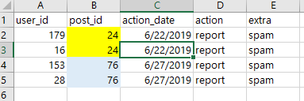

# SQL Server - COUNT DISTINCT

**Author:** DeeDeeCG
**Votes:** 14
**Link:** [https://leetcode.com/problems/reported-posts-ii/solutions/2936798/](https://leetcode.com/problems/reported-posts-ii/solutions/2936798/)

---

# Intuition\r
* Use counts from two data sets and then join results together to get the overrall percentage.\r
\r
# Approach\r
* FULL DISCLOSURE: I kept getting an answer of 61.61, off by about 0.20. I decided to look at some solutions to find out what I was doing wrong.\r
* I didn't take into account that the post_id in the "actions" table could have duplicates, even if the user_id is different. For reference look at the below image or post_id 24 and 76 in the "Case 2" data.\r
* Once I realized this, I used DISTINCT COUNT to get my answer. Below is my solution, I spent a lot of time on this problem so I didn't really optimize it.\r
---\r
\r
\r
---\r
# Code\r
```\r
with cte as\r
(\r
select\r
	a.action_date\r
	,count(distinct r.post_id) as cnt_removal\r
	,count(distinct a.post_id) as cnt_total\r
from dbo.actions as a\r
left join dbo.removals as r\r
on a.post_id = r.post_id\r
\r
where a.extra = 'spam'\r
\r
group by\r
	a.action_date\r
)\r
select\r
	round(sum(c.cnt_removal*1.0 / c.cnt_total)*100 / count(*),2) as average_daily_percent \r
from cte as c;\r
```