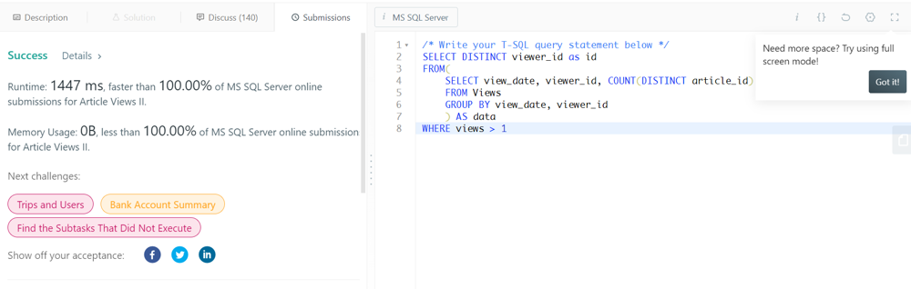

# don't forget the distinct in the SELECT clause

**Author:** PeterHontaru
**Votes:** 3
**Link:** [https://leetcode.com/problems/article-views-ii/solutions/1381110/](https://leetcode.com/problems/article-views-ii/solutions/1381110/)

---

```
SELECT DISTINCT viewer_id as id
FROM(
    SELECT view_date, viewer_id, COUNT(DISTINCT article_id) as views
    FROM Views
    GROUP BY view_date, viewer_id
    ) AS data
WHERE views > 1
ORDER BY 1
```


