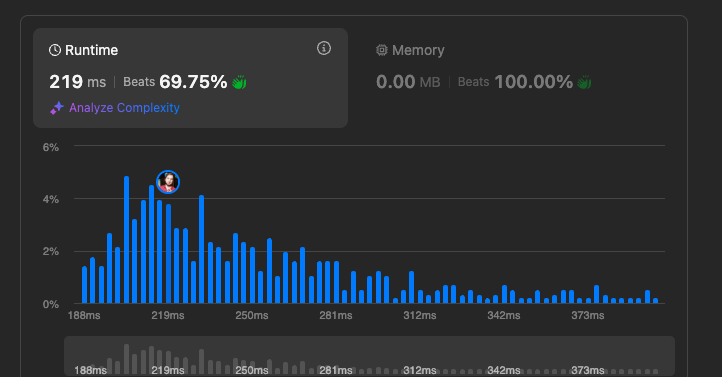

# PostreSQL solution with good explanation

**Author:** alexlinus
**Votes:** 12
**Link:** [https://leetcode.com/problems/average-selling-price/solutions/5992434/](https://leetcode.com/problems/average-selling-price/solutions/5992434/)

---

# Approach
<!-- Describe your approach to solving the problem. -->

Since some products may not be sold, we should select from Prices table with **LEFT JOIN** (to keep them in a result table). For such products there will be null in average_price column, to avoid that I used **CASE** clause to catch such cases and display 0.

To get specific price on the date of purchaise we should use **BETWEEN** clause to match rows.

**Why did i use here cast?**

Since **SUM** of integer units returns in postgresql integer (whole number), we should cast one of the values to "numeric" type (numeric type is a decimal in postresql to store precise values like money).

**Why not float?**
Because **ROUND** doesn't work with float type in PostgreSQL.


# Complexity 



# Code
```postgresql []
-- Write your PostgreSQL query statement below

SELECT 
    p.product_id,
    CASE
        WHEN SUM(u.units) is null
        THEN 0
        ELSE
            ROUND(SUM(u.units * p.price) / SUM(u.units)::numeric, 2)
    END
    AS average_price
FROM 
    Prices p
LEFT JOIN 
    UnitsSold u
ON 
    u.product_id = p.product_id 
    AND u.purchase_date BETWEEN p.start_date AND p.end_date
GROUP BY 
    p.product_id;


```


