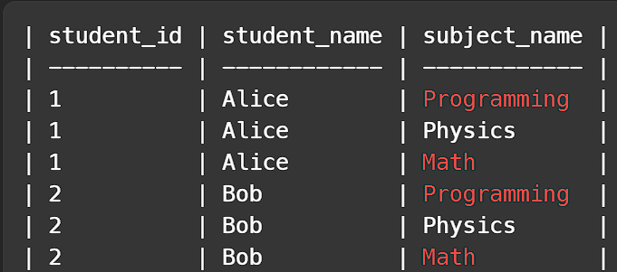
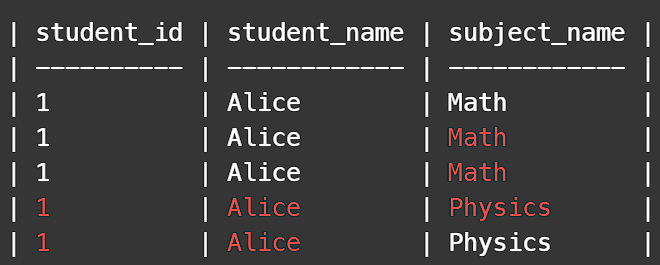
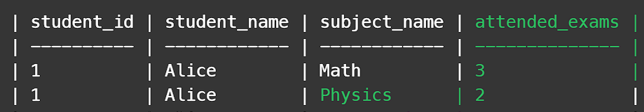
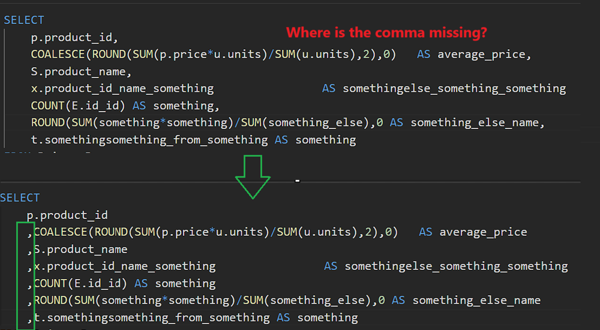

# ✅ REAL explained step by step  ✅12/50 | All SQL50

**Author:** Piotr_Maminski
**Votes:** 303
**Link:** [https://leetcode.com/problems/students-and-examinations/solutions/5874925/](https://leetcode.com/problems/students-and-examinations/solutions/5874925/)

---


```mysql []
SELECT
    S.student_id
    ,S.student_name
    ,SU.subject_name
    ,COUNT(E.student_id) attended_exams
FROM Students S
CROSS JOIN Subjects SU
LEFT JOIN Examinations E
    ON S.student_id = E.student_id
    AND SU.subject_name = E.subject_name

GROUP BY S.student_id, S.student_name, SU.subject_name
ORDER BY S.student_id, S.student_name, SU.subject_name
;
```
```mssql [MS SQL Server]
SELECT
    S.student_id
    ,S.student_name
    ,SU.subject_name
    ,COUNT(E.student_id) attended_exams
FROM Students S
CROSS JOIN Subjects SU
LEFT JOIN Examinations E
    ON S.student_id = E.student_id
    AND SU.subject_name = E.subject_name

GROUP BY S.student_id, S.student_name, SU.subject_name
ORDER BY S.student_id, S.student_name, SU.subject_name
;
```
```oraclesql [Oracle]
SELECT
    S.student_id
    ,S.student_name
    ,SU.subject_name
    ,COUNT(E.student_id) attended_exams
FROM Students S
CROSS JOIN Subjects SU
LEFT JOIN Examinations E
    ON S.student_id = E.student_id
    AND SU.subject_name = E.subject_name

GROUP BY S.student_id, S.student_name, SU.subject_name
ORDER BY S.student_id, S.student_name, SU.subject_name
;
```
```postgresql [PostgreSQL]
SELECT
    S.student_id
    ,S.student_name
    ,SU.subject_name
    ,COUNT(E.student_id) attended_exams
FROM Students S
CROSS JOIN Subjects SU
LEFT JOIN Examinations E
    ON S.student_id = E.student_id
    AND SU.subject_name = E.subject_name

GROUP BY S.student_id, S.student_name, SU.subject_name
ORDER BY S.student_id, S.student_name, SU.subject_name
;
```
```pythondata [Pandas]
# Time: O(n) , Space: O(n) 
import pandas as pd

def students_and_examinations(students: pd.DataFrame, subjects: pd.DataFrame, examinations: pd.DataFrame) -> pd.DataFrame:
    
    df = students.merge(subjects, how='cross')
    examinations.rename(columns={'subject_name':'subject_name2'},inplace=True)
    df_result=df.merge(examinations, how='left', left_on=['student_id','subject_name'], right_on=['student_id','subject_name2'])

    return df_result.groupby(['student_id','student_name','subject_name'], dropna=False)['subject_name2'].count().reset_index(name='attended_exams')
```


# Step by Step

First, let's group subjects by student.

```
SELECT
    student_id
    ,student_name
    ,subject_name
```
Our goal is to list the subjects for each student.

Like this:
```
| student_id | student_name | subject_name |
| ---------- | ------------ | ------------ |
| 1          | Alice        | Programming  |
| 1          | Alice        | Physics      |
| 1          | Alice        | Math         |
| 2          | Bob          | Programming  |
| 2          | Bob          | Physics      |
| 2          | Bob          | Math         |
```
We're going to use a **CROSS JOIN** (Cartesian product) 

which is like making every possible pair of rows from two tables.


```
SELECT
    student_id
    ,student_name
    ,subject_name
FROM Students 
CROSS JOIN Subjects
```


Output:


Now we need to add the exam results.

Time to **LEFT JOIN** so we can show a '0' for subjects students didn't take, it will be clear later.


```
LEFT JOIN Examinations E

```
connect this table to the others

```
LEFT JOIN Examinations E
    ON E.student_id = S.student_id
    AND E.subject_name = SU.subject_name
```

And ordered the results

```
ORDER BY S.student_id, S.student_name, SU.subject_name
```

```
SELECT
    s.student_id
    ,s.student_name
    ,SU.subject_name
FROM Students S
CROSS JOIN Subjects SU
LEFT JOIN Examinations E
    ON E.student_id = S.student_id
    AND E.subject_name = SU.subject_name
ORDER BY S.student_id, S.student_name, SU.subject_name
```
Output:


Each attempt at Alice's exam is displayed one after another.

And we want to count them.

Like this:



We will use **Count()** 

What exactly are we counting? We could count either e.subject_id or e.student_id, but the way we **GROUP** the data will be crucial.

We want to count the attempts of a given person, so now we need to assign the result to people and then to their subjects

We want to find out how many times Alice has taken an exam in a SPECIFIC subject


```
COUNT(e.subject_id) AS attended_exams
```
and we need to **GROUP** the results
```
GROUP BY S.student_id, S.student_name, Su.subject_name
```

final code:
```mysql []
SELECT
    S.student_id
    ,S.student_name
    ,Su.subject_name
    ,COUNT(E.student_id) attended_exams
FROM Students S
CROSS JOIN Subjects Su
LEFT JOIN Examinations E
    ON S.student_id = E.student_id
    AND Su.subject_name = E.subject_name
GROUP BY S.student_id, S.student_name, Su.subject_name
ORDER BY S.student_id, S.student_name, Su.subject_name
```
Output:
```
| student_id | student_name | subject_name | attended_exams |
| ---------- | ------------ | ------------ | -------------- |
| 1          | Alice        | Math         | 3              |
| 1          | Alice        | Physics      | 2              |
| 1          | Alice        | Programming  | 1              |
| 2          | Bob          | Math         | 1              |
| 2          | Bob          | Physics      | 0              |
| 2          | Bob          | Programming  | 1              |
```

#### BONUS: Comma in SELECT
why do I write commas at the beginning of a line?

If a query doesn't work just because of a missing comma, I save hours of searching. Helps with longer queries, good practice, coworker friendly.



I put a lot of work into it, so pretty please with sugar on top...


