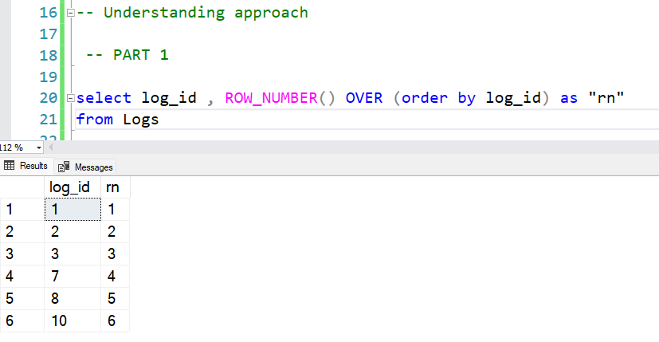
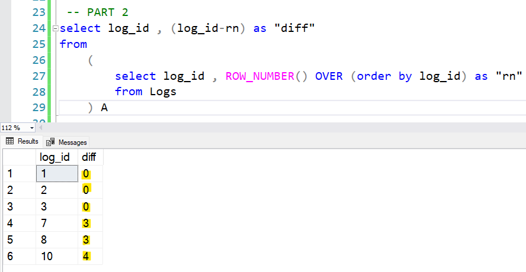

# Very Easy MS SQL Server Solution using SUB QUERY + ROW_NUMBER() approach

**Author:** Vaishnav-Dahake
**Votes:** 12
**Link:** [https://leetcode.com/problems/find-the-start-and-end-number-of-continuous-ranges/solutions/2632388/](https://leetcode.com/problems/find-the-start-and-end-number-of-continuous-ranges/solutions/2632388/)

---

**Solution Code :-**

```
select min(A.log_id) as "start_id" , max(A.log_id) as "end_id"
from
	(
		select log_id , ROW_NUMBER() OVER (order by log_id) as "rn"
		from Logs
	) A
group by (log_id-rn)
```


***Understanding approach :-***
To better understand the solution code please refer the image below :-

***Image 1 :***



***Image 2 :***




As per the images we can see that the difference, "**diff**" between "**log_id**" column and row_number column "**rn**" is ***"not 0"*** when the continuous range **breaks** for "**log_id**" column. Hence in order to get "**start_id**" and "**end_id**", we just need to group by this "**diff**" column i.e. "**log_id-rn**" and do **min(log_id)** to get **start_id** & **max(log_id)** to get **end_id**. (As represented in **Solution code** at the top)


Hope it helps :)
Kindly upvote if it does.