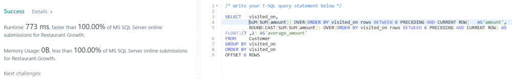

# MSSQL answer 5 lines, 100.00, window function

**Author:** user4273yK
**Votes:** 65
**Link:** [https://leetcode.com/problems/restaurant-growth/solutions/480070/](https://leetcode.com/problems/restaurant-growth/solutions/480070/)

---

```
/* Write your T-SQL query statement below */

SELECT   visited_on, 
         SUM(SUM(amount)) OVER(ORDER BY visited_on ROWS BETWEEN 6 PRECEDING AND CURRENT ROW)   AS'amount',
         ROUND(CAST(SUM(SUM(amount)) OVER(ORDER BY visited_on ROWS BETWEEN 6 PRECEDING AND CURRENT ROW) AS FLOAT)/7.0 ,2) AS'average_amount' 
FROM     Customer 
GROUP BY visited_on
ORDER BY visited_on
OFFSET 6 ROWS  
```



