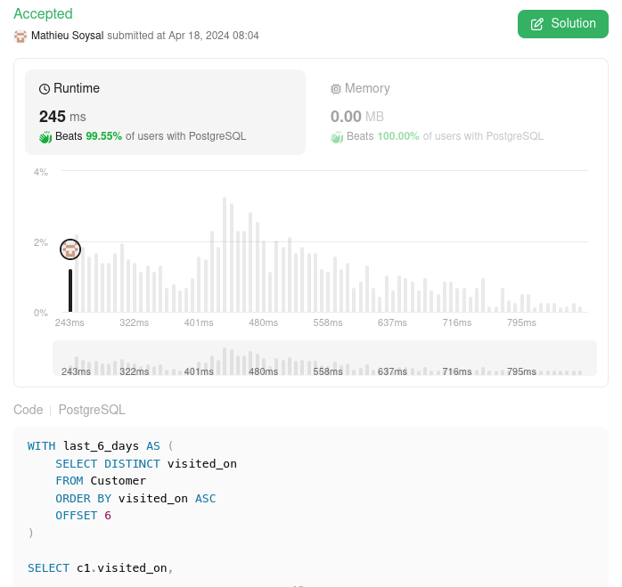

# 🌟 Well explained PostgreSQL solution 🚀 Beats 99%+ 🌠

**Author:** MathieuSoysal
**Votes:** 19
**Link:** [https://leetcode.com/problems/restaurant-growth/solutions/5040002/](https://leetcode.com/problems/restaurant-growth/solutions/5040002/)

---



# Explain

- **last_6_days**: The CTE *last_6_days* selects distinct dates (visited_on) from the Customer table, orders them in ascending order, and uses OFFSET 6 to skip the first 6 rows, effectively selecting dates starting from the 7th most recent date.

- **Final SELECT**: The main query joins the *last_6_days* CTE with the Customer table (c2) on a condition that matches records from c2 where `visited_on` is within the 7-day range ending on each date from *last_6_days* (`c1.visited_on`). It then groups the results by `c1.visited_on` and calculates two aggregates:
    - `SUM(c2.amount)`: The total amount spent by customers in the 7-day range.
    - `ROUND(SUM(c2.amount) / 7., 2)`: The average amount spent per day over the 7-day range, rounded to two decimal places.


## What it's good for performance

- **Minimise number of rows before joining**:
  - uses `DISTINCT` to eliminate duplicate dates, reducing the number of rows to process.
  - `ORDER BY` with `OFFSET` efficiently navigates to the desired starting point in the dataset.

- **Strongly filtered JOIN**:
    - The `BETWEEN` operation in the join condition is an efficient way to filter the data to the relevant 7-day range for each date in the *last_6_days* CTE.   

- **Minimise number of JOIN and GROUP BY**:
    - The query has only one `GROUP BY` and one filtered `JOIN`

# Code
```
WITH last_6_days AS (
    SELECT DISTINCT visited_on
    FROM Customer
    ORDER BY visited_on ASC
    OFFSET 6
)

SELECT c1.visited_on,
        SUM(c2.amount) AS amount,
        ROUND(SUM(c2.amount) / 7., 2)  AS average_amount
FROM last_6_days AS c1
INNER JOIN Customer AS c2
ON c2.visited_on BETWEEN c1.visited_on - 6 AND c1.visited_on
GROUP BY c1.visited_on;
```

____

If it was useful don't hesitate to upvote \uD83C\uDF20 Or keep it in your favorite \uD83C\uDF1F
