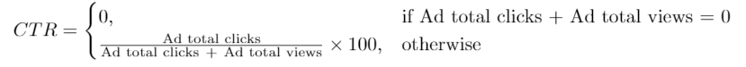

# [1322. Ads Performance](https://leetcode.com/problems/ads-performance/)

| Category | Difficulty | Likes | Dislikes |
| :------: | :--------: | :---: | :------: |
| Database | Easy | 273 | 67 |

**Tags:** [`database`](https://leetcode.com/tag/database)

**Companies:** `facebook`

## Description

Table: `Ads`

```

+---------------+---------+
| Column Name   | Type    |
+---------------+---------+
| ad_id         | int     |
| user_id       | int     |
| action        | enum    |
+---------------+---------+
(ad_id, user_id) is the primary key (combination of columns with unique values) for this table.
Each row of this table contains the ID of an Ad, the ID of a user, and the action taken by this user regarding this Ad.
The action column is an ENUM (category) type of (&#39;Clicked&#39;, &#39;Viewed&#39;, &#39;Ignored&#39;).

```

 

A company is running Ads and wants to calculate the performance of each Ad.

Performance of the Ad is measured using Click-Through Rate (CTR) where:



Write a solution to find the `ctr` of each Ad. **Round** `ctr` to **two decimal points**.

Return the result table ordered by `ctr` in **descending order** and by `ad_id` in **ascending order** in case of a tie.

The result format is in the following example.

 

**Example 1:**

```

Input: 
Ads table:
+-------+---------+---------+
| ad_id | user_id | action  |
+-------+---------+---------+
| 1     | 1       | Clicked |
| 2     | 2       | Clicked |
| 3     | 3       | Viewed  |
| 5     | 5       | Ignored |
| 1     | 7       | Ignored |
| 2     | 7       | Viewed  |
| 3     | 5       | Clicked |
| 1     | 4       | Viewed  |
| 2     | 11      | Viewed  |
| 1     | 2       | Clicked |
+-------+---------+---------+
Output: 
+-------+-------+
| ad_id | ctr   |
+-------+-------+
| 1     | 66.67 |
| 3     | 50.00 |
| 2     | 33.33 |
| 5     | 0.00  |
+-------+-------+
Explanation: 
for ad_id = 1, ctr = (2/(2+1)) * 100 = 66.67
for ad_id = 2, ctr = (1/(1+2)) * 100 = 33.33
for ad_id = 3, ctr = (1/(1+1)) * 100 = 50.00
for ad_id = 5, ctr = 0.00, Note that ad_id = 5 has no clicks or views.
Note that we do not care about Ignored Ads.

```

---

**Links:** [Submissions](https://leetcode.com/problems/ads-performance/) | [Solutions](https://leetcode.com/problems/ads-performance/)
