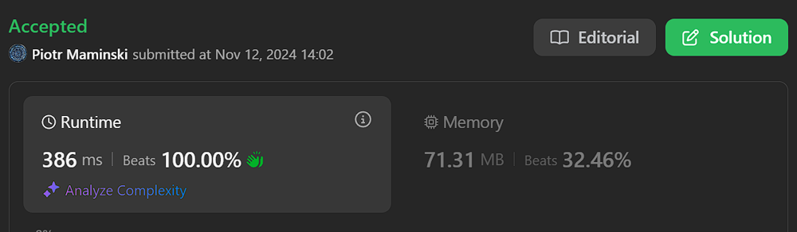

# ✅ Clean code, Correct

**Author:** Piotr_Maminski
**Votes:** 0
**Link:** [https://leetcode.com/problems/ads-performance/solutions/6037296/](https://leetcode.com/problems/ads-performance/solutions/6037296/)

---

# Upvote if I should write premium solutions and if anyone reads them. That way I will know.



# Clear Code
```pythondata [Pandas short]
import pandas as pd
import numpy as np 

def ads_performance(ads: pd.DataFrame) -> pd.DataFrame:
    metrics = ads.assign(
        clicks=(ads['action'] == 'Clicked').astype(int),
        total=(ads['action'] != 'Ignored').astype(int)
    )
    return (metrics
        .groupby('ad_id')[['clicks', 'total']]
        .sum()
        .reset_index()
        .assign(ctr=lambda x: round(x['clicks'] * 100 / x['total'], 2))
        .fillna(0)[['ad_id', 'ctr']]
        .sort_values(['ctr', 'ad_id'], ascending=[False, True]))
```
```pythondata [Pandas]
import pandas as pd
import numpy as np
from typing import Final

def ads_performance(ads_data: pd.DataFrame) -> pd.DataFrame:
    """
    Calculate Click-Through Rate (CTR) for each advertisement.
    
    Args:
        ads_data: DataFrame containing ad interactions with columns 'ad_id' and 'action'
        
    Returns:
        DataFrame with ad_id and corresponding CTR percentage, sorted by CTR (desc) and ad_id (asc)
    """
    # Constants
    CLICK_ACTION: Final = 'Clicked'
    IGNORE_ACTION: Final = 'Ignored'
    
    # Calculate clicks and total interactions
    performance_metrics = ads_data.assign(
        clicks=lambda x: (x['action'] == CLICK_ACTION).astype(int),
        total=lambda x: (x['action'] != IGNORE_ACTION).astype(int)
    )
    
    # Aggregate metrics by ad_id
    aggregated_metrics = (
        performance_metrics
        .groupby('ad_id')[['clicks', 'total']]
        .sum()
        .reset_index()
    )
    
    # Calculate CTR percentage
    result = (
        aggregated_metrics
        .assign(ctr=lambda x: round(x['clicks'] * 100 / x['total'], 2))
        .fillna(0)[['ad_id', 'ctr']]
        .sort_values(['ctr', 'ad_id'], ascending=[False, True])
    )
    
    return result
```
```mysql []
SELECT 
    ad_id,
    ROUND(
        IFNULL(
            100.0 * 
            (
                SUM(action = 'Clicked') / 
                (
                    SUM(action = 'Clicked') + 
                    SUM(action = 'Viewed')
                )
            ),
            0 
        ),
        2   
    ) AS ctr
FROM Ads
GROUP BY ad_id
ORDER BY 
    ctr DESC,   
    ad_id ASC;
```
```MySQL [MSServer,PosgreSQL,Oracle,MySQL]
SELECT 
    ad_id,
    ROUND(
        CASE 
            WHEN (SUM(CASE WHEN action = 'Clicked' THEN 1 ELSE 0 END) + 
                  SUM(CASE WHEN action = 'Viewed' THEN 1 ELSE 0 END)) = 0 
            THEN 0
            ELSE 100.0 * SUM(CASE WHEN action = 'Clicked' THEN 1 ELSE 0 END) / 
                 (SUM(CASE WHEN action = 'Clicked' THEN 1 ELSE 0 END) + 
                  SUM(CASE WHEN action = 'Viewed' THEN 1 ELSE 0 END))
        END,
        2
    ) AS ctr
FROM Ads
GROUP BY ad_id
ORDER BY 
    ctr DESC,
    ad_id ASC;
```
```MySQL [Oracle]
SELECT 
    ad_id,
    ROUND(
        NVL(
            100.0 * 
            (
                SUM(CASE WHEN action = 'Clicked' THEN 1 ELSE 0 END) / 
                NULLIF(
                    SUM(CASE WHEN action = 'Clicked' THEN 1 ELSE 0 END) + 
                    SUM(CASE WHEN action = 'Viewed' THEN 1 ELSE 0 END),
                    0
                )
            ),
            0
        ),
        2
    ) AS ctr
FROM Ads
GROUP BY ad_id
ORDER BY 
    ctr DESC,
    ad_id ASC
```
```MySQL [PostgreSQL]
SELECT 
    ad_id,
    ROUND(
        COALESCE(
            100.0 * 
            (
                SUM(CASE WHEN action = 'Clicked' THEN 1 ELSE 0 END)::decimal / 
                NULLIF(
                    SUM(CASE WHEN action = 'Clicked' THEN 1 ELSE 0 END) + 
                    SUM(CASE WHEN action = 'Viewed' THEN 1 ELSE 0 END),
                    0
                )
            ),
            0
        ),
        2
    ) AS ctr
FROM Ads
GROUP BY ad_id
ORDER BY 
    ctr DESC,
    ad_id ASC
```
# I'll expand if someone even reads it.
# Have a nice day! <3


