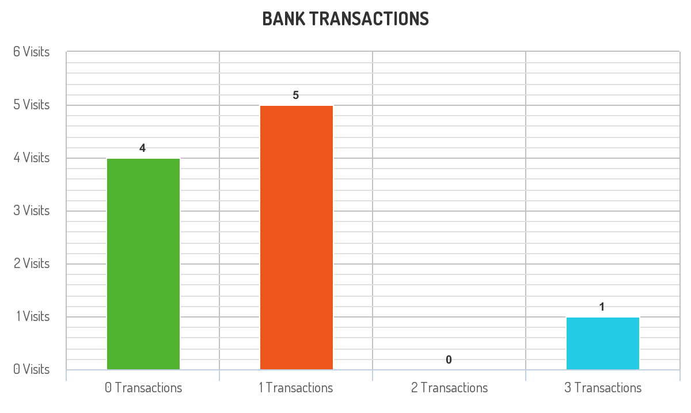

# [1336. Number of Transactions per Visit](https://leetcode.com/problems/number-of-transactions-per-visit/)

| Category | Difficulty | Likes | Dislikes |
| :------: | :--------: | :---: | :------: |
| Database | Hard | 95 | 327 |

**Tags:** [`database`](https://leetcode.com/tag/database)

**Companies:** `machine-zone`, `machinezone`

## Description

Table: `Visits`

```

+---------------+---------+
| Column Name   | Type    |
+---------------+---------+
| user_id       | int     |
| visit_date    | date    |
+---------------+---------+
(user_id, visit_date) is the primary key (combination of columns with unique values) for this table.
Each row of this table indicates that user_id has visited the bank in visit_date.

```

 

Table: `Transactions`

```

+------------------+---------+
| Column Name      | Type    |
+------------------+---------+
| user_id          | int     |
| transaction_date | date    |
| amount           | int     |
+------------------+---------+
This table may contain duplicates rows.
Each row of this table indicates that user_id has done a transaction of amount in transaction_date.
It is guaranteed that the user has visited the bank in the transaction_date.(i.e The Visits table contains (user_id, transaction_date) in one row)

```

 

A bank wants to draw a chart of the number of transactions bank visitors did in one visit to the bank and the corresponding number of visitors who have done this number of transaction in one visit.

Write a solution to find how many users visited the bank and didn't do any transactions, how many visited the bank and did one transaction, and so on.

The result table will contain two columns:

	- `transactions_count` which is the number of transactions done in one visit.

	- `visits_count` which is the corresponding number of users who did `transactions_count` in one visit to the bank.

`transactions_count` should take all values from `0` to `max(transactions_count)` done by one or more users.

Return the result table ordered by `transactions_count`.

The result format is in the following example.

 

**Example 1:**


```

Input: 
Visits table:
+---------+------------+
| user_id | visit_date |
+---------+------------+
| 1       | 2020-01-01 |
| 2       | 2020-01-02 |
| 12      | 2020-01-01 |
| 19      | 2020-01-03 |
| 1       | 2020-01-02 |
| 2       | 2020-01-03 |
| 1       | 2020-01-04 |
| 7       | 2020-01-11 |
| 9       | 2020-01-25 |
| 8       | 2020-01-28 |
+---------+------------+
Transactions table:
+---------+------------------+--------+
| user_id | transaction_date | amount |
+---------+------------------+--------+
| 1       | 2020-01-02       | 120    |
| 2       | 2020-01-03       | 22     |
| 7       | 2020-01-11       | 232    |
| 1       | 2020-01-04       | 7      |
| 9       | 2020-01-25       | 33     |
| 9       | 2020-01-25       | 66     |
| 8       | 2020-01-28       | 1      |
| 9       | 2020-01-25       | 99     |
+---------+------------------+--------+
Output: 
+--------------------+--------------+
| transactions_count | visits_count |
+--------------------+--------------+
| 0                  | 4            |
| 1                  | 5            |
| 2                  | 0            |
| 3                  | 1            |
+--------------------+--------------+
Explanation: The chart drawn for this example is shown above.
* For transactions_count = 0, The visits (1, &quot;2020-01-01&quot;), (2, &quot;2020-01-02&quot;), (12, &quot;2020-01-01&quot;) and (19, &quot;2020-01-03&quot;) did no transactions so visits_count = 4.
* For transactions_count = 1, The visits (2, &quot;2020-01-03&quot;), (7, &quot;2020-01-11&quot;), (8, &quot;2020-01-28&quot;), (1, &quot;2020-01-02&quot;) and (1, &quot;2020-01-04&quot;) did one transaction so visits_count = 5.
* For transactions_count = 2, No customers visited the bank and did two transactions so visits_count = 0.
* For transactions_count = 3, The visit (9, &quot;2020-01-25&quot;) did three transactions so visits_count = 1.
* For transactions_count &gt;= 4, No customers visited the bank and did more than three transactions so we will stop at transactions_count = 3

```

---

**Links:** [Submissions](https://leetcode.com/problems/number-of-transactions-per-visit/) | [Solutions](https://leetcode.com/problems/number-of-transactions-per-visit/)
