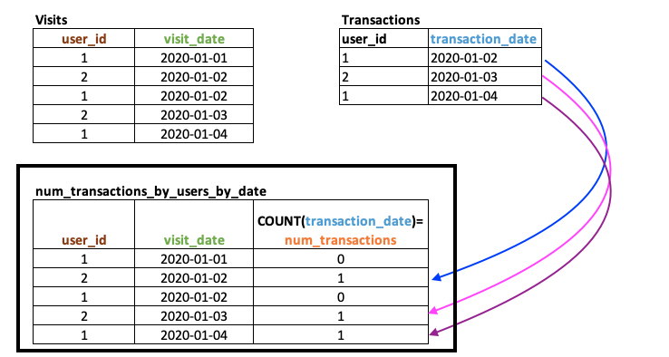
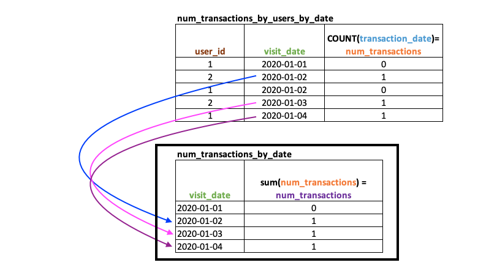
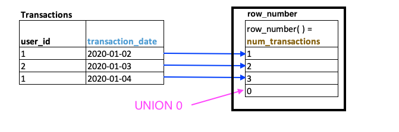
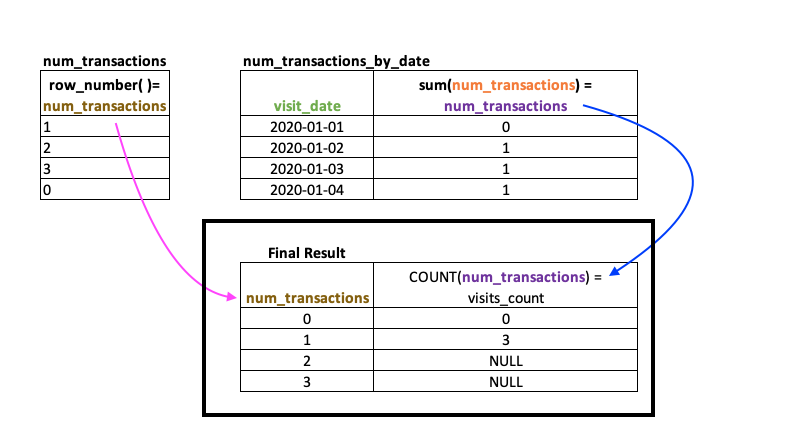

# My SQL with DETAILED explanation

**Author:** leixueli
**Votes:** 33
**Link:** [https://leetcode.com/problems/number-of-transactions-per-visit/solutions/802890/](https://leetcode.com/problems/number-of-transactions-per-visit/solutions/802890/)

---

**Tricky part of problem**
This problem involves a few translations between the number of visits--> number of transactions --> number of occurances and so it is really easy to aggregate the wrong column. Also, it is easy to confuse which aggregate function to use.
* Do you aggregate `visit_date` or `transaction_date`
* Do you `SUM` or `COUNT`?

**Tip: Work backwards to figure out which tables you will ultimately need**

In the final solution you need the following:
+-------------------+--------------+
| transactions_count | visits_count |
+-------------------+--------------+
But to get that you need a table like this:
+----------+---------------------------+
 | visit_date | num_transactions_by_date |
+----------+---------------------------+
But to get `num_transactions_by_date` you need a table like this:
+------+----------+-------------------------------------+
| users | visit_date | num_transactions_by_users_by_date
+------+----------+-------------------------------------+

**CTE Tables needed**
`num_transactions_by_users_by_date`


`num_transactions_by_date`


`num_transactions` ( aka **row_number**)


`final_table` (still need to remove `NULL` rows but we will deal with that below)


**STEP 1. Create CTEs**
a. Tip: test each CTE to make sure they work before creating final table.
--> Use smaller test case to make it easier to see if expected results are corect
--> Comment out filter after successful run
--> I used `where user_id in (1,2)`
b. Tip: If expected results only returning on row but there should be multiple, likely mising a `GROUP BY` statement

**STEP 2. Write out query that will return the `max_num_transactions` based off of CTE table `num_transactions`**
--> We will use this to filter out `NULL` values in the final query
--> Test it out and make sure it only returns a single value
--> We are using this only as reference for step 3, so comment out so it does not affect the rest of the code. 

**STEP 3. Create final select query**
a. Make sure to use `COUNT` and not `SUM` when calcuating `visits_count` column. 
--> SUM will return a `NULL` value if no entry while `COUNT` will return `0`
b. Remove rows where the value in the `transactions` column is is greater than `max_num_transactions` from step 2
 --> Uncomment Select query from step 3 
--> Highlight/copy entire SELECT query
--> Paste into final query (Make sure to paste inside of parentheses)

**Pseudocode for  CTE tables**
```sql
WITH
	## This is to add 0s to dates when user visite but didn't complete a transaction
    num_transactions_by_users_by_date AS -- ntbubd
    (< insert query1 here>)
    
    , num_transactions_by_date as --ntbd 
     (< insert query2 here>)

	-- This is to list the give an ordered list starting from 0 up to the max_number_transactions
    ,num_transactions as --nt 
     (< insert query3 here>)
```

**Final MySQL Query**
```sql
WITH 
    # This is to add 0s to dates when user visite but didn't complete a transaction
    num_transactions_by_users_by_date AS #nvbubd
    (
        SELECT v.user_id
            , visit_date
            , count(transaction_date) AS num_transactions
        FROM visits v
        LEFT JOIN Transactions t        
        ON v.user_id = t.user_id
        AND v.visit_date = t.transaction_date
        -- where v.user_id in (1,2) -- for testing only
        GROUP BY 1, 2
        ORDER BY 1, 2
    )
    
    , num_transactions_by_date AS #ntbd
    (
        SELECT user_id  # not really necessary but leaving it in for testing small use case
            ,visit_date
            , sum(num_transactions) AS num_transactions
        FROM num_transactions_by_users_by_date
        -- where user_id in (1,2)  # for testing only
        GROUP BY 1,2
        ORDER BY 1,2
    )
    
    # This is to list the give an ordered list starting from 0 up to the max_number_transactions      
    ,num_transactions AS #nt
    (
        SELECT row_number() over () as num_transactions
        FROM transactions
        UNION select 0   
    )
    
# ******************************************   
# Test CTEs
# ******************************************   

# SELECT * FROM num_transactions_by_users_by_date
# SELECT * FROM num_transactions_by_date
# SELECT * FROM num_transactions


# ******************************************   
# Max number of calculations
# ****************************************** 

# SELECT MAX(num_transactions) FROM num_transactions_by_date

# ******************************************   
# Final Query
# ******************************************  

SELECT nt.num_transactions AS transactions_count
	, COUNT(ntbd.num_transactions) AS visits_count
FROM num_transactions AS nt
LEFT JOIN num_transactions_by_date AS ntbd
ON nt.num_transactions = ntbd.num_transactions
WHERE nt.num_transactions <= (SELECT MAX(num_transactions) FROM num_transactions_by_date)
# AND ntbd.user_id in (1,2) -- for testing only
GROUP BY 1
ORDER by 1
```

**Take aways and learnings after many multiple failed attempts.**
Mapping things out on whiteboard with expected results before writing the query was most helpful in keeping everything straight

*My solution is based off of https://leetcode.com/problems/number-of-transactions-per-visit/discuss/727649/MySQL-with-explanation-(no-variables-used) *