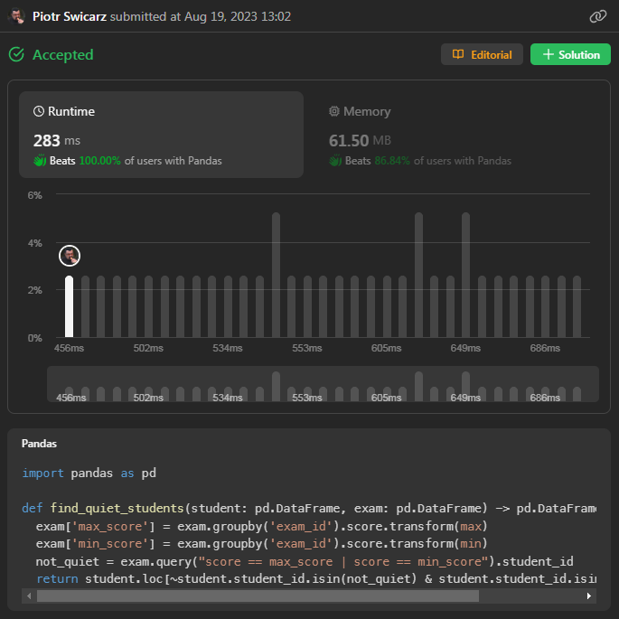

# Pandas - find by reverse - 100% fastest

**Author:** piocarz
**Votes:** 1
**Link:** [https://leetcode.com/problems/find-the-quiet-students-in-all-exams/solutions/3930952/](https://leetcode.com/problems/find-the-quiet-students-in-all-exams/solutions/3930952/)

---

# Intuition
Instead of scanning each person if he wasn't in top1, find list of people who were top1, and exclude them.
# Approach
- 1. & 2. For each exam create column with min and max score - use window function of `.transform()`
- 3. Find all students who match max or min criteria.
- 4. From list of all people exclude those who did score max or min, and count only those which actually took any exam.


# Code
```
import pandas as pd

def find_quiet_students(student: pd.DataFrame, exam: pd.DataFrame) -> pd.DataFrame:
  exam["max_score"] = exam.groupby("exam_id").score.transform(max)
  exam["min_score"] = exam.groupby("exam_id").score.transform(min)
  not_quiet = exam.query("score == max_score | score == min_score").student_id
  return student.loc[~student["student_id"].isin(not_quiet) & student["student_id"].isin(exam.student_id)]
```
# Performance

