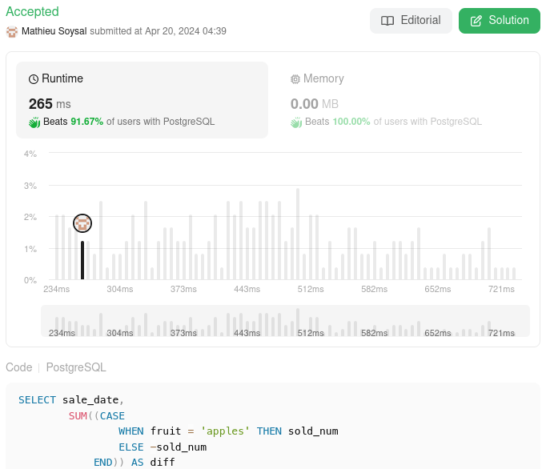

# 🌟 Simplified PostgreSQL solution 🚀 Beats 91%+ 🌠

**Author:** MathieuSoysal
**Votes:** 6
**Link:** [https://leetcode.com/problems/apples-oranges/solutions/5048017/](https://leetcode.com/problems/apples-oranges/solutions/5048017/)

---



# Explain 

- `SUM((CASE WHEN fruit = 'apples' THEN sold_num ELSE -sold_num END)) AS diff`: This is a conditional aggregation. The `CASE` statement inside the SUM function checks each row to see if the fruit column has the value `'apples'`. If it does, it takes the `sold_num` value as is. If the fruit is not `'apples'`, it negates the `sold_num` (multiplies it by -1). The `SUM` function then adds up all these values for each group defined by the `GROUP BY` clause. The result of this sum is given an alias *diff*, which will appear as a column in the output.


# Code
```PostgreSQL []
SELECT sale_date,
        SUM((CASE 
                WHEN fruit = 'apples' THEN sold_num
                ELSE -sold_num
            END)) AS diff
FROM Sales
GROUP BY sale_date
ORDER BY sale_date;
```
```MySQL []
SELECT sale_date,
        SUM((CASE 
                WHEN fruit = 'apples' THEN sold_num
                ELSE -sold_num
            END)) AS diff
FROM Sales
GROUP BY sale_date
ORDER BY sale_date;
```
```SQL_SERVER []
SELECT sale_date,
        SUM((CASE 
                WHEN fruit = 'apples' THEN sold_num
                ELSE -sold_num
            END)) AS diff
FROM Sales
GROUP BY sale_date
ORDER BY sale_date;
```
```Oracle []
SELECT TO_CHAR(sale_date, 'yyyy-MM-dd') AS sale_date,
        SUM((CASE 
                WHEN fruit = 'apples' THEN sold_num
                ELSE -sold_num
            END)) AS diff
FROM Sales
GROUP BY sale_date
ORDER BY sale_date;
```

____

If it was useful don't hesitate to upvote \uD83C\uDF20 Or keep it in favorite \uD83C\uDF1F
