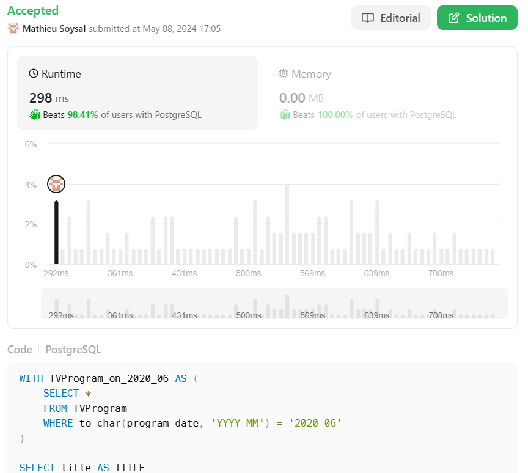

# 🌟 Explained performand PostgreSQL solution 🚀 Beats 98%+ 🌠

**Author:** MathieuSoysal
**Votes:** 0
**Link:** [https://leetcode.com/problems/friendly-movies-streamed-last-month/solutions/5006976/](https://leetcode.com/problems/friendly-movies-streamed-last-month/solutions/5006976/)

---




# Explanation

1. **Common Table Expression (CTE) Creation**:

    1. ``WITH TVProgram_on_2020_06 AS``: This line starts the definition of a CTE named TVProgram_on_2020_06.
    2. ``SELECT * FROM TVProgram``: This part of the CTE selects all columns from the TVProgram table.
    3. ``WHERE TO_CHAR(program_date, 'YYYY-MM') = '2020-06'``: The ``WHERE`` clause filters the rows to only include those where the ``program_date`` falls in June 2020. The ``TO_CHAR`` function converts the ``program_date`` to a string in the format 'YYYY-MM' for this comparison.

2. **Main Query Execution**:

    1. ``SELECT title AS TITLE``: This line selects the title column from the ``Content`` table and aliases it as ``TITLE``.
    2. ``FROM Content AS m``: This specifies that the Content table is being queried and it is aliased as m for reference in the query.

3. **Filtering Content**:

    1. ``WHERE content_type = 'Movies'``: The query filters the results to only include rows where the ``content_type`` column has the value ``'Movies'``.
    2. ``AND Kids_content = 'Y'``: It further narrows down the results to only include rows where the ``Kids_content`` column has the value ``'Y'``, indicating that the content is suitable for children.

4. **Subquery with EXISTS Clause**:
    1. ``AND EXISTS``: This part of the query checks for the existence of at least one row that satisfies the condition specified in the subquery that follows.
    2. ``(SELECT 1 FROM TVProgram_on_2020_06 AS tv WHERE tv.content_id = m.content_id)``: The subquery selects a constant value ``1`` (which is just a placeholder to check for existence) from the previously defined CTE ``TVProgram_on_2020_06`` where there is a match between the content_id in the CTE and the ``content_id`` in the ``Content`` table (aliased as ``m``). The alias tv is used for referencing the CTE within the subquery.

## What is performand in this query

- **Do not have any expensive clause**
    - In this query we dont have exepnsive clause like `JOIN` (cost can be $$O(n^2)$$), or `DISTINCT`(cost can be $$O(n*log(n))$$)
- **Usage of EXISTS**
    - **Early Termination**: ``EXISTS`` stops processing as soon as it finds a match. It doesn't matter if there's one or a hundred matches; as soon as one is found, the subquery returns true, and no further records are checked.
    - **Index Utilization**: If the subquery in the ``EXISTS`` clause can make use of indexes, the database can quickly determine the existence of the required data without scanning the entire table.
    - **Focus on Existence, Not Data Retrieval**: ``EXISTS`` is used to check for the existence of rows that satisfy the condition, not to retrieve data from these rows. This can be faster than other operations that require data to be returned and processed.
- **Reducing the table size before usage of EXISTS clause**
    - Before the usage of ``EXISTS`` we hqve reduced the size of `TVPrograme` table with the usage of CTE.
- **Strongly conditioned usqge of EXISTS**
    - The ``EXISTS`` clause is only use when `content_type = 'Movies'
        AND Kids_content = 'Y'` are `true`.
# Code
``` PostgreSQL []
WITH TVProgram_on_2020_06 AS (
    SELECT *
    FROM TVProgram
    WHERE TO_CHAR(program_date, 'YYYY-MM') = '2020-06'
)

SELECT title AS TITLE
FROM Content AS m
WHERE content_type = 'Movies'
        AND Kids_content = 'Y'
        AND EXISTS (
            SELECT 1
            FROM TVProgram_on_2020_06 AS tv
            WHERE tv.content_id = m.content_id);
```
``` MySQL []
WITH TVProgram_on_2020_06 AS (
    SELECT *
    FROM TVProgram
    WHERE DATE_FORMAT(program_date, '%Y-%m') = '2020-06'
)
SELECT title AS TITLE
FROM Content AS m
WHERE content_type = 'Movies'
    AND Kids_content = 'Y'
    AND EXISTS (
        SELECT 1
        FROM TVProgram_on_2020_06 AS tv
        WHERE tv.content_id = m.content_id
    );
```
``` Oracle []
WITH TVProgram_on_2020_06 AS (
    SELECT *
    FROM TVProgram
    WHERE to_char(program_date, 'YYYY-MM') = '2020-06'
)
SELECT title AS TITLE
FROM Content m
WHERE content_type = 'Movies'
    AND Kids_content = 'Y'
    AND EXISTS (
        SELECT 1
        FROM TVProgram_on_2020_06 tv
        WHERE tv.content_id = m.content_id
    );
```
``` MSSQL []
WITH TVProgram_on_2020_06 AS (
    SELECT *
    FROM TVProgram
    WHERE FORMAT(program_date, 'yyyy-MM') = '2020-06'
)
SELECT title AS TITLE
FROM Content AS m
WHERE content_type = 'Movies'
    AND Kids_content = 'Y'
    AND EXISTS (
        SELECT 1
        FROM TVProgram_on_2020_06 AS tv
        WHERE tv.content_id = m.content_id
    );
```

____

If it was useful don't hesitate to upvote \uD83C\uDF20 Or keep it in favorite \uD83C\uDF1F
