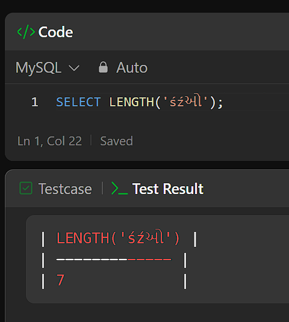

# ✅5/50 | All SQL50 Explained

**Author:** Piotr_Maminski
**Votes:** 5
**Link:** [https://leetcode.com/problems/invalid-tweets/solutions/5869726/](https://leetcode.com/problems/invalid-tweets/solutions/5869726/)

---

# Code
```mysql []
SELECT tweet_id
FROM Tweets
WHERE CHAR_LENGTH(content) > 15
;
```
```mssql [MS SQL Server]
SELECT tweet_id
FROM Tweets
WHERE LEN(content) > 15;
;
```
```oraclesql [Oracle]
SELECT tweet_id
FROM Tweets
WHERE LENGTH(content) > 15
;
```
```postgresql [PostgreSQL]
SELECT tweet_id
FROM Tweets
WHERE CHAR_LENGTH(content) > 15
;
```
```pythondata [Pandas]
# Time: O(n) , Space: O(n) 
import pandas as pd

def invalid_tweets(tweets: pd.DataFrame) -> pd.DataFrame:
    return tweets[tweets['content'].str.len()>15][['tweet_id']]

```
### System differences
MS SQL Server - **LEN()** is synonymous with CHAR_LENGTH() in MySQL.
Oracle - **LENGTH()** is synonymous with CHAR_LENGTH() in MySQL.
## So why CHAR_LENGTH?

LENGTH() counts in bytes. Some characters occupy more than one byte. CHAR_LENGTH() counts characters and is safer.





# Order of Execution


1. **FROM** Tweets
2. **WHERE** The condition **CHAR_LENGTH(content)** > 15 is applied to filter rows
3. **SELECT** tweet_id


