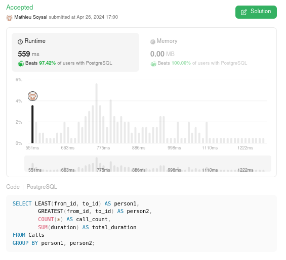

# 🌟 Explained performand PostgreSQL solution  🚀 Beats 97%+ 🌠

**Author:** MathieuSoysal
**Votes:** 8
**Link:** [https://leetcode.com/problems/number-of-calls-between-two-persons/solutions/5076066/](https://leetcode.com/problems/number-of-calls-between-two-persons/solutions/5076066/)

---



# Explain


- `LEAST(from_id, to_id) AS person1`: This part selects the smaller of the two IDs (`from_id` or `to_id`) and labels it as `person1`. This ensures that for any pair of individuals, they will have the same `person1` identifier regardless of who called whom.

- `GREATEST(from_id, to_id) AS person2`: This selects the larger of the two IDs and labels it as `person2`. Similar to `person1`, this ensures consistency in identifying the pair.


## What is performand in this query

- **Usage of LEAST and GREATEST function**
    - The `LEAST` and `GREATEST` functions are designed to be efficient and are likely optimized by the PostgreSQL query planner. 
- **Not use subquery**
    - Additional step of creating a derived table can introduce overhead because the database has to compute the results of the `CASE` statements for the entire Calls table before it can apply the `GROUP BY` clause. 

# Code
``` PostgreSQL []
SELECT LEAST(from_id, to_id) AS person1,
        GREATEST(from_id, to_id) AS person2,
        COUNT(*) AS call_count,
        SUM(duration) AS total_duration
FROM Calls
GROUP BY person1, person2;
```
``` Oracle []
SELECT
  LEAST(from_id, to_id) AS person1,
  GREATEST(from_id, to_id) AS person2,
  COUNT(*) AS call_count,
  SUM(duration) AS total_duration
FROM
  Calls
GROUP BY
  LEAST(from_id, to_id),
  GREATEST(from_id, to_id);
```
``` MySQL []
SELECT
  LEAST(from_id, to_id) AS person1,
  GREATEST(from_id, to_id) AS person2,
  COUNT(*) AS call_count,
  SUM(duration) AS total_duration
FROM
  Calls
GROUP BY person1, person2;
```
``` MS_SQL_Server []
SELECT
  CASE WHEN from_id < to_id THEN from_id ELSE to_id END AS person1,
  CASE WHEN from_id > to_id THEN from_id ELSE to_id END AS person2,
  COUNT(*) AS call_count,
  SUM(duration) AS total_duration
FROM
  Calls
GROUP BY
  CASE WHEN from_id < to_id THEN from_id ELSE to_id END,
  CASE WHEN from_id > to_id THEN from_id ELSE to_id END;
```

____

If it was useful don't hesitate to upvote \uD83C\uDF20 Or keep it in your favorite \uD83C\uDF1F
