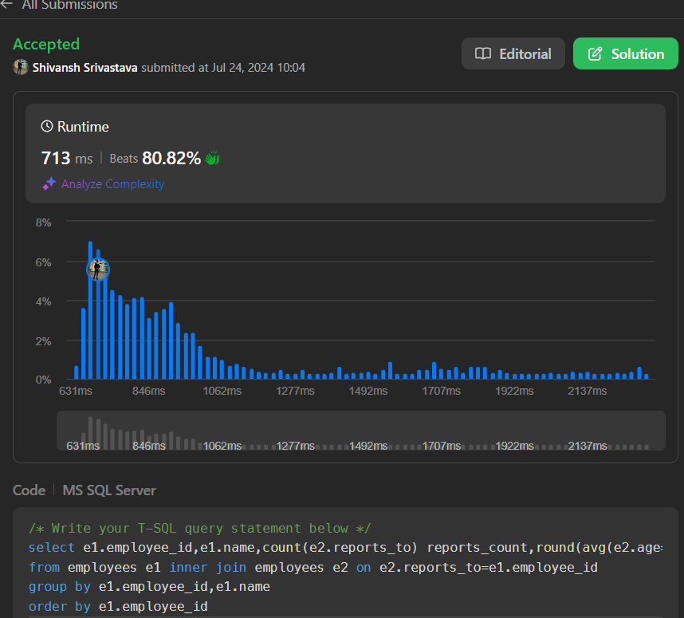

# easy to understand ms sql

**Author:** shivanshsrii
**Votes:** 5
**Link:** [https://leetcode.com/problems/the-number-of-employees-which-report-to-each-employee/solutions/5525940/](https://leetcode.com/problems/the-number-of-employees-which-report-to-each-employee/solutions/5525940/)

---

# Intuition

<!-- Describe your first thoughts on how to solve this problem. -->

# Approach
<!-- Describe your approach to solving the problem. -->

# Complexity
- Time complexity:
<!-- Add your time complexity here, e.g. $$O(n)$$ -->

- Space complexity:
<!-- Add your space complexity here, e.g. $$O(n)$$ -->

# Code
```
/* Write your T-SQL query statement below */
select e1.employee_id,e1.name,count(e2.reports_to) reports_count,round(avg(e2.age*1.00),0) average_age
from employees e1 inner join employees e2 on e2.reports_to=e1.employee_id
group by e1.employee_id,e1.name
order by e1.employee_id
```