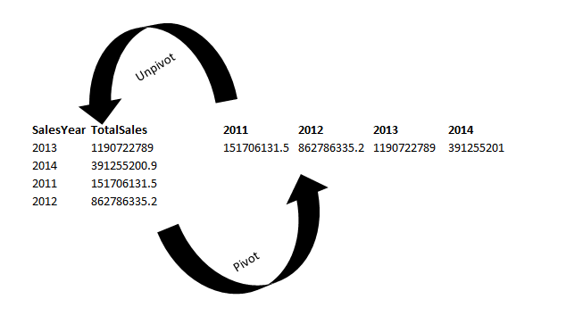

# UNPIVOT. UNNEST( ARRAY[ ] )

**Author:** dggrey
**Votes:** 9
**Link:** [https://leetcode.com/problems/rearrange-products-table/solutions/5086919/](https://leetcode.com/problems/rearrange-products-table/solutions/5086919/)

---

#### `UNNEST` function serve to transform data from a \u201Cwide\u201D format to a \u201Clong\u201D format




**PostgreSQL does not have a built-in UNPIVOT function** like Oracle or SQL Server

---

1 column: `UNNEST(c)`
\\> 1: `UNNEST(ARRAY[c1, c2, c3])`

# Code
```
SELECT 
    product_id, 
    store,
    price
FROM (
  SELECT 
    product_id, 
    UNNEST(ARRAY['store1', 'store2', 'store3']) AS store,
    UNNEST(ARRAY[store1, store2, store3]) AS price
  FROM 
    Products
) AS unpivot
WHERE price IS NOT NULL

```
> `UNNEST(ARRAY['store1', 'store2', 'store3'])`
It can be also like `['Store1', 'Store22', 'Store333']`, because it's just a list of names of the further "melted" columns (`ARRAY[store1, store2, store3]`)
